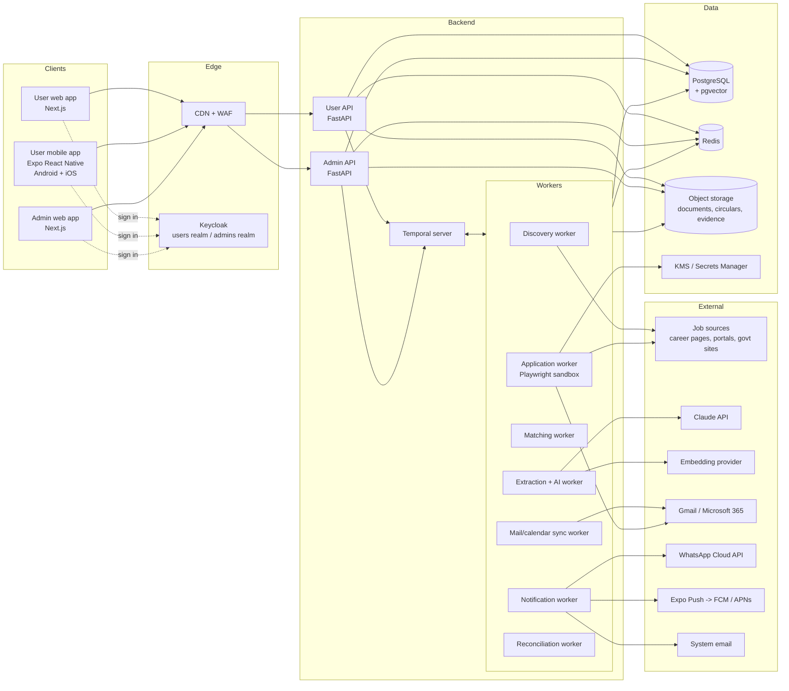
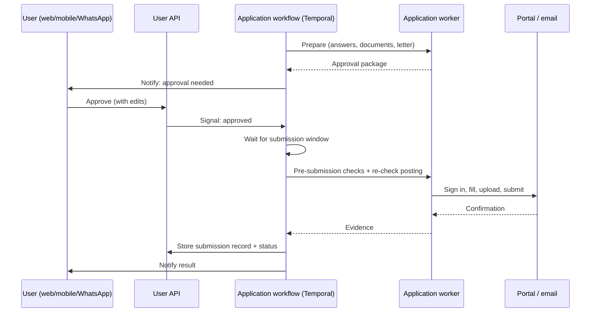

# System Architecture

This document is the architecture overview. Technology names are in [03-Technology-Stack.md](03-Technology-Stack.md); storage choices in [04-Data-and-Storage.md](04-Data-and-Storage.md); AI in [05-AI-Design.md](05-AI-Design.md). The full detailed design (C4 levels, domain model, extensibility, data model, state machines, sequences, API, events, security, infrastructure, ADRs) is in [Design/](Design/README.md); where the two differ, the Design folder is more detailed and wins.

## 1. Architecture style

- **Backend: modular monolith plus workers.** One Python codebase, split into domain modules (profile, opportunities, matching, applications, notifications, admin, and so on). It is deployed as a few processes: the user API, the admin API, and background workers. This keeps development simple for a new team while letting heavy work (crawling, browser automation, AI) scale separately.
- **Durable workflows for anything long-running or external.** Discovery cycles, the application pipeline (requirements Section 27.1), approvals that wait for days, scheduled submissions at 12:00 a.m., pauses, retries, and reconciliation all run as Temporal workflows. These survive restarts, never lose their place, and give the "no blind resubmission" guarantee (requirements Section 23.2).
- **Events for integration.** Modules publish versioned domain events through a transactional outbox to an event bus (EventBridge + SQS), so modules stay decoupled and can later become separate services ([Design/10-Event-Architecture.md](Design/10-Event-Architecture.md)).
- **Plugins for everything external.** Sources, application routes, notification channels, document transformers, and country rules are plugins; most growth is configuration ([Design/05-Extensibility-Framework.md](Design/05-Extensibility-Framework.md)).
- **API-first.** The backend publishes an OpenAPI contract. The web app, mobile app, and admin app use generated typed clients, so the three front ends never drift from the backend.
- **Separate user and admin surfaces** (requirements Section 53.1): different apps, domains, sign-in realms, and API deployments over the same data.

## 2. Context diagram

## 3. Backend modules

| Module | Responsibility | Main requirement sections |
|---|---|---|
| `identity` | Users, admin accounts, roles, sessions, MFA, re-authentication | 13, 41, 53.2 |
| `profile` | Profile facts, education, employment, tests, identity details, referees, change history | 5, 19, 35.1, 46 |
| `documents` | Document library, versions, conversion, photo/signature resizing, validation | 19, 32.2 |
| `preferences` | Tracks, filters, thresholds, countries, compensation, windows, pauses, notification settings | 5.2, 5.3, 6, 47–49, 51 |
| `sources` | Source registry, connectors, search cycles, coverage | 7.1, 7.2, 18 |
| `opportunities` | Extraction results, versions, archive, dedup, fraud flags | 7.3–7.6, 42, 50 |
| `matching` | Hard filters, scoring, explanations, recommendation history | 6.1, 22, 52.2 |
| `applications` | Approval packages, application records, status model, submission records, question bank | 10, 20, 28, 37 |
| `automation` | Rules, precedence, caps, pre-submission checks, emergency stop | 10.1, 10.8, 27, 38 |
| `portals` | Portal accounts, encrypted credentials, route adapters | 10.5, 29, 30 |
| `mail` | User mailbox send/read, threads, replies | 10.2, 11.4, 31 |
| `notifications` | Push, WhatsApp, email, digests, reports, quiet hours, actions from notifications | 11.3, 28.4, 36 |
| `academic` | Programs, tests, scores, referees, supervisor outreach, offers | 9, 33 |
| `government` | Circular specifics, stages, fees, applicant copies | 8.4, 35 |
| `tracking` | Interviews, assessments, offers, insights | 11.5, 34 |
| `audit` | Append-only audit events, reconciliation | 24.3, 52.3 |
| `admin` | Admin dashboard queries, management actions, platform settings | 53 |
| `ai` | All Claude calls, prompts, evals, cost tracking | [05-AI-Design.md](05-AI-Design.md) |

Rules for modules:
- A module owns its tables; other modules use its service functions, not its tables directly.
- Cross-cutting rules have one home (requirements Section 45): the status model lives in `applications`, precedence in `automation`, pause in `preferences`, archive in `opportunities`, compensation in `preferences`.

## 4. Key flows

### 4.1 Daily discovery

1. A Temporal schedule starts a discovery cycle per source, respecting each source's rate limits.
2. The discovery worker fetches listings, stores raw snapshots in object storage, and records the cycle (requirements Section 18.1).
3. The extraction worker uses Claude to turn each new or changed posting into structured fields with evidence; scanned or PDF circulars go to Claude as documents.
4. Dedup groups the posting with existing opportunities; fraud checks run.
5. The matching worker applies hard filters (countries, compensation, eligibility) in code, computes scores, and writes recommendations.
6. The notification worker sends the digest at each user's chosen time.

### 4.2 Approve-each application (requirements Section 37)

If a new question appears after approval, the workflow pauses only for that question and sends a notification with a quick-answer action (requirements Section 37.4).

### 4.3 External-action safety

Every external action (submit, send, pay, create an account) follows the same steps:

1. Write an "intent" record with an idempotency key.
2. Perform the action.
3. Write the outcome record with evidence.
4. If the outcome is unknown, mark "Outcome unknown" and start verification. Never retry blindly.

Steps 1 and 3 make interrupted actions visible (requirements Section 52.3).

## 5. Application routes (adapters)

Each route has its own adapter behind a common interface (`prepare`, `fill`, `validate`, `submit`, `confirm`):

| Adapter | Approach |
|---|---|
| Email | Gmail API / Microsoft Graph from the user's own mailbox |
| Common applicant-tracking systems (for example Greenhouse, Lever, Workday, SmartRecruiters, Ashby) | Dedicated Playwright adapters, one per system |
| Bangladesh government portal(s) | Dedicated adapter; stops for fee payment and user-only steps |
| University portals | Dedicated adapters for the most common systems; others guided manual |
| Generic career pages | Claude maps form fields to profile answers; filling is done by deterministic code; stricter checks; falls back to manual guidance |
| LinkedIn and sites that prohibit automation | Guided manual apply: prepared materials plus link; no automated submission |

Browser automation runs in isolated, short-lived containers with no access to other users' data. It never solves CAPTCHAs or evades bot detection (requirements Sections 10.3, 27.3).

## 6. Security architecture (summary)

- Two Keycloak realms: `users` and `admins`. Admin realm requires MFA; admin API reachable only from the admin app's domain and, optionally, an IP allow-list.
- All data encrypted in transit (TLS) and at rest. Portal credentials and OAuth tokens use envelope encryption with KMS; they are never returned by any API, including the admin API (requirements Section 53.5).
- Row-level security in Postgres keeps each user's rows separate; the admin API uses a separate database role.
- Untrusted content (job postings, emails, web pages) is always treated as data in AI prompts and never as instructions (requirements Section 25.2).
- Append-only audit log for all admin views of sensitive data and all external actions.

## 7. Environments

| Environment | Purpose | Data |
|---|---|---|
| Local | Developer machines via Docker Compose | Synthetic |
| Dev | Every merge to `main` | Synthetic |
| Staging | Release candidates, beta testing, store review builds | Synthetic plus consenting beta users |
| Production | Live | Real |

Outbound submissions are disabled in local, dev, and staging by default; they go to sandbox mailboxes and mock portals so tests never apply to real jobs.
