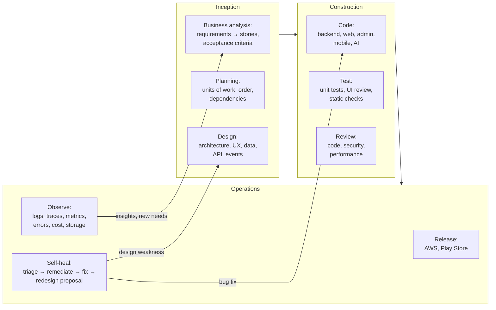
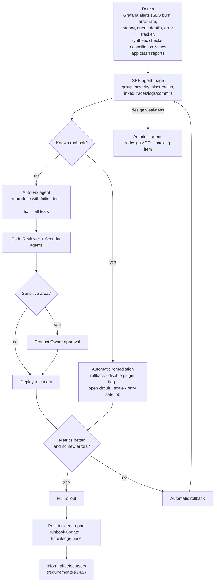

# AIDLC: AI-Driven Development Lifecycle and Agents

CareerPilot is built and operated with **AIDLC**: AI agents do the work across the whole lifecycle (analysis, planning, design, coding, testing, release, and production operations), and people validate at a small number of checkpoints. This replaces the human-centred Scrum cadence in [01-Delivery-Plan.md](01-Delivery-Plan.md).

## 1. Lifecycle

- Work is done in **bolts**: short cycles of hours to a few days, each delivering one tested unit of work. Bolts replace two-week sprints. They are grouped into the same increments as the roadmap in [01-Delivery-Plan.md](01-Delivery-Plan.md).
- Each phase ends with a **checkpoint**. Agents prepare the evidence, and the Product Owner validates (§4).

## 2. Agent roster

All agents are Claude-based. Each has its own instructions, tools, permissions, inputs, outputs, and quality gate. Agent definitions live in the repository (`.claude/agents/`), so they are versioned and reviewed like code.

| # | Agent | Phase | Does | Outputs | Quality gate |
|---|---|---|---|---|---|
| 1 | **Orchestrator** | All | Breaks increments into bolts, assigns agents, tracks progress, escalates blockers | Bolt plan, status board updates | Every bolt has an owner agent, inputs, and a done condition |
| 2 | **Business Analyst** | Inception | Turns requirements into stories with acceptance criteria and requirement IDs; checks consistency (requirements §45); finds gaps and contradictions | Stories, traceability matrix, gap reports | Every acceptance criterion maps to requirement IDs; no contradictions |
| 3 | **Planner** | Inception | Orders work by dependency and value; estimates; plans releases | Ordered backlog, increment plan | Dependencies resolved; critical path known |
| 4 | **Architect / Designer** | Inception, Ops | Designs modules, data, APIs, events; writes ADRs; turns production design weaknesses into redesign proposals | Design docs, ADRs, OpenAPI and event schema changes | Fits [Design/](Design/README.md) principles; ADR for every significant change |
| 5 | **UX/UI Designer** | Inception | Designs flows and screens to [16-UX-Design.md](16-UX-Design.md); keeps design tokens and component library | Flow diagrams, screen specs, Figma frames | Heuristic review passed; accessible; consistent with design system |
| 6 | **Backend Developer** | Construction | Implements modules, workflows, plugins | Code + tests | All tests pass; module boundaries respected |
| 7 | **Web Developer** | Construction | Implements user web and admin features | Code + tests | Tests pass; matches screen specs |
| 8 | **Mobile Developer** | Construction | Implements Android and iOS features (Expo) | Code + tests | Tests pass on Android and iOS emulators; small-screen layouts checked |
| 9 | **AI/ML Engineer** | Construction | Builds AI tasks, prompts, embeddings, scoring features | Prompts, AI code, unit tests with recorded responses | Unit tests pass; production quality metrics within targets ([05-AI-Design.md](05-AI-Design.md)) |
| 10 | **Data / Database** | Construction, Ops | Writes migrations, indexes, queries; checks query plans and data growth | Migrations, index changes | Expand-and-contract; no slow queries above budget |
| 11 | **Test Engineer** | Construction | Writes and maintains unit tests (the only test type in v1); finds flaky tests; keeps coverage | Tests, coverage reports | Coverage targets met; no flaky tests in required checks |
| 12 | **UI Validation** | Construction | Reviews screens against specs (a review, not automated tests): design-guide compliance, accessibility rules, form validation messages, layout at every breakpoint, usability heuristics | UI review report with screenshots | No accessibility issues; validation rules complete |
| 13 | **Code Reviewer** | Construction | Reviews every pull request for correctness, clarity, and rule compliance | Review comments, approve/request changes | No unresolved high-severity findings |
| 14 | **Security** | Construction, Ops | Reviews security-sensitive changes, scans results, threat-model updates, secret checks | Security review, issues | No high/critical findings open |
| 15 | **Performance Analyst** | Construction, Ops | Analyses production latency, throughput, and profiles; finds regressions and bottlenecks | Performance report, fixes or issues | Performance targets met in production monitoring ([11-Observability.md](11-Observability.md)) |
| 16 | **Capacity, Storage and Cost** | Ops | Tracks database and storage growth, log volume, queue sizes, AI/messaging spend; forecasts; proposes clean-up and cost savings | Weekly capacity and cost report | Forecast within budget; no store above 70% capacity without a plan |
| 17 | **DevOps / Release** | Ops | Maintains CI/CD, Docker, Terraform; deploys to AWS; builds and submits Android app to Play Store | Pipelines, releases, release notes | Release checklist passed; rollback ready |
| 18 | **SRE / Production Analyst** | Ops | Watches dashboards and alerts; detects anomalies; correlates logs, traces, metrics; triages incidents | Incident records, triage reports | Every alert triaged within target time |
| 19 | **Auto-Fix** | Ops | Reproduces a production problem with a failing test, fixes it, opens a pull request | Fix PR with reproduction test | All tests pass; reviewed by Code Reviewer and Security agents |
| 20 | **Compliance and Privacy** | All | Checks data handling against requirements §13, §40, §43; maintains Play Store data-safety answers and privacy policy content | Compliance report | No unapproved personal-data use |
| 21 | **Documentation** | All | Keeps requirements, plans, runbooks, API docs, and changelog up to date | Doc updates | Docs match behaviour |

## 3. How agents run

| Trigger | Agents | Runs in |
|---|---|---|
| New or changed requirement | Business Analyst → Planner → Architect / UX | Claude Code session (interactive or headless) |
| Bolt starts | Orchestrator assigns Developer + Test Engineer agents | Claude Code with subagents; one git worktree per agent |
| Pull request opened | Code Reviewer, Security, UI Validation, Test Engineer | GitHub Actions with Claude Code |
| Nightly | Performance Analyst (production performance and profiles), Capacity/Cost, Test Engineer (flaky test hunt) | Scheduled jobs |
| Alert or new error in production | SRE → Auto-Fix (or runbook remediation) → Architect if design-level | Webhook from Grafana / error tracker to an agent runner |
| Weekly | Capacity/Cost report, Compliance check, Documentation sync | Scheduled jobs |

Agent access rule (standing authorization from the Product Owner):

- **Full project access, no permission prompts.** All AIDLC agents may read, create, update, move, and delete any file inside the project directory without asking the user. This is configured in the shared Claude Code settings (`.claude/settings.json`: edits auto-accepted, project-wide read/edit allowed, common development commands pre-approved) and stated in `CLAUDE.md`.
- **All commands, no questions.** Claude may run any shell command (Bash, PowerShell, cmd) needed for CareerPilot and may use the development machine for this project only. It never installs system-wide software or elevates (sudo, admin): missing tools are listed in `docs/runbooks/machine-setup.md` for the user to install, the dependent task is marked `- [!]`, and work continues with the recommended workaround.
- **Continuous work.** Agents don't stop until every task in `specs/*/tasks.md` is done; they make the recommended choice instead of asking and record it in the spec. A Claude Code Stop hook (`scripts/hooks/keep_working.py`) blocks stopping while tasks are open (it gives up after three stops with no progress). `scripts/autopilot.ps1` resumes the session after usage limits reset (for example the 5-hour limit). Tasks needing the Product Owner are marked `- [!]` and skipped, never waited on. Pause with the file `.claude/autopilot-off`.
- The authorization covers the project directory only. It does not cover force-pushing, production deployments of sensitive changes, real external actions (applications, emails, payments), or anything outside the project directory; those follow the checkpoints in §4.
- Every change is still committed in small portions with all tests passing first, so any change can be reviewed and reverted.

Agent working rules:

- **Documents follow the requirements automatically.** Whenever a requirement is added, changed, or removed during development, the agent making the change (with the Documentation agent) updates every affected document in the same change: other requirement sections (acceptance criteria, test scenarios, decisions, cross-references), `Planning/`, `Planning/Design/`, `specs/`, `README.md`, and `CLAUDE.md`. A Claude Code hook (`scripts/hooks/requirements_changed.py`, configured in `.claude/settings.json`) reminds the agent automatically after every edit of the requirements file. A weekly Documentation agent run checks the whole document set for drift.
- **Development rules.** All code follows [19-Development-Rules.md](19-Development-Rules.md); the Code Reviewer agent rejects any change that breaks it (hard-coded values, raw status strings, missing audit columns, physical deletes, SOLID violations).
- **Specs first.** Before building a feature, the Business Analyst and Architect agents create or update its spec in `specs/<epic>-<feature>/` (requirements, design, tasks, test plan) ([17-Project-Structure.md](17-Project-Structure.md) §3).
- **Designs by the UX/UI agent.** Every screen on web, admin, and mobile is designed by the UX/UI Designer agent to [16-UX-Design.md](16-UX-Design.md), responsive at all breakpoints, then checked by the UI Validation agent.
- **No seed data.** Environments start empty and tests build their own data; product defaults go in `config/` ([18-Seed-Data.md](18-Seed-Data.md)).
- **Redis by the rules.** Caching, rate limiting, sessions, and locks follow [Design/16-Redis-and-Caching.md](Design/16-Redis-and-Caching.md).
- **Tests named and placed by convention** (`*.spec.ts(x)`, `test_*.py`) per [17-Project-Structure.md](17-Project-Structure.md) §4.

Agent rules (in each agent's instructions):

- Read the requirements and design before acting; use the single definitions (requirements §45).
- Never weaken safeguards, never handle real user data outside production systems, never send real applications, payments, or other email outside production (account email a person asks for themselves may use the configured mail service, as in `docs/runbooks/email-setup.md`).
- Production agents see only scrubbed logs and traces (no personal data or secrets).
- Every agent action is logged with its inputs, outputs, and cost.
- Agent spend has daily budgets; the Capacity/Cost agent reports it.

## 4. Human checkpoints

Agents do the work; the Product Owner validates at these points only:

| Checkpoint | What is validated |
|---|---|
| End of Inception for an increment | Stories, acceptance criteria, designs, and screen specs |
| Sensitive changes | Authentication, credentials, payments, automation safety, data deletion, database structure changes, AI prompt changes that affect user-facing writing |
| Releases | Production release and Play Store submission |
| Redesign proposals | ADRs from production analysis |
| Monthly | Cost, capacity, quality, and agent performance review |

Everything else (non-sensitive code, tests, docs, runbook remediations) can be merged and deployed by agents when all gates pass.

## 5. Self-healing loop (production)

Limits (requirements §24.3): automatic remediation never weakens safeguards, never deletes user data, and never performs external actions for users. Sensitive fixes always need human approval.

## 6. Knowledge base for agents

- Requirements, plans, designs, ADRs, runbooks, post-incident reports, and test reports are kept in the repository so every agent reads the same knowledge.
- Each incident adds a runbook entry and, where possible, an automatic remediation and an alert, so the same problem is handled faster next time.
- Agent performance is tracked: bolts completed, defects found later, rework, fix success rate, and cost per bolt.
