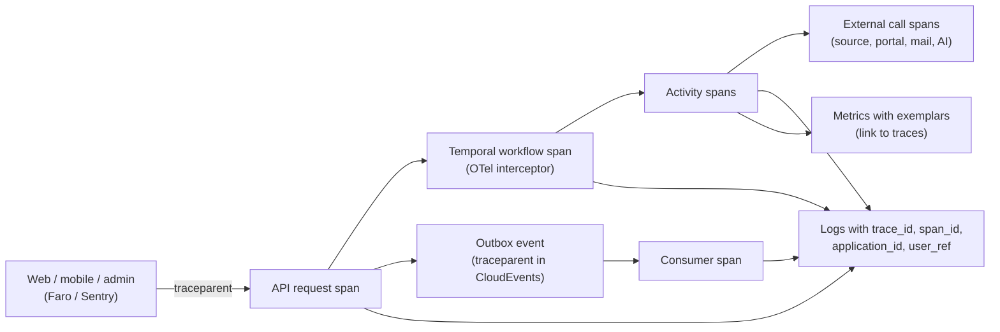

# Observability: Logs, Traces, Metrics, Profiles, Errors

Everything is tracked in **Grafana** using **OpenTelemetry** (a vendor-neutral standard), so the backend can switch between self-hosted and cloud Grafana without code changes. This plan replaces the observability summary in [Design/13-Infrastructure-and-Operations.md](Design/13-Infrastructure-and-Operations.md) §7.

## 1. Stack (free options)

| Signal | Tool | Local (Docker) | Production (low cost) |
|---|---|---|---|
| Collection | OpenTelemetry SDKs + **Grafana Alloy** (OpenTelemetry Collector distribution) | Alloy container | Alloy on each host |
| Metrics | **Prometheus** (Grafana Mimir in cloud) | All-in-one `grafana/otel-lgtm` container | **Grafana Cloud free tier** |
| Logs | **Loki** | same | Grafana Cloud free tier |
| Traces | **Tempo** | same | Grafana Cloud free tier |
| Profiles (CPU/memory) | **Pyroscope** | same | Grafana Cloud free tier |
| Web front-end monitoring (page loads, errors, user journeys) | **Grafana Faro** web SDK | to local Alloy | Grafana Cloud free tier (Frontend Observability) |
| Mobile crashes and errors | **Sentry** free plan (best Expo/React Native support), linked to traces | Sentry dev project | Sentry free plan |
| Dashboards and alerts | **Grafana** | Local Grafana | Grafana Cloud |
| Synthetic checks (is the site up, can a user log in) | Grafana synthetic monitoring | — | Grafana Cloud free quota |

Grafana Cloud's free tier has monthly limits (metrics series, log and trace volume, retention of about two weeks). Check the current limits at sign-up. If usage outgrows the free tier, the fallback is self-hosting the same stack (Loki, Tempo, Prometheus, Grafana) on a small instance. Sampling and log-level rules (§3, §4) keep usage inside the free limits at launch.

## 2. Correlation: one ID through everything

Every log line, span, and metric exemplar carries `trace_id`. Business IDs (`application_id`, `opportunity_id`, `workflow_id`) are added as attributes, so one application's whole journey can be found in seconds (quality target in [Design/01-Principles-and-Quality-Attributes.md](Design/01-Principles-and-Quality-Attributes.md)).

## 3. Logging standard

| Rule | Detail |
|---|---|
| Format | JSON, one event per line |
| Required fields | `timestamp`, `level`, `service`, `version`, `environment`, `trace_id`, `span_id`, `event` (stable name), `message` |
| Context fields | `tenant_id`, `user_ref` (pseudonymous hash, not the user ID or email), `application_id`, `opportunity_id`, `workflow_id`, `plugin_key` |
| Levels | `ERROR` (needs action), `WARN` (unexpected but handled), `INFO` (business events, state changes), `DEBUG` (off in production unless enabled per service for a short time) |
| Never logged | Passwords, tokens, credentials, document contents, NID/passport numbers, full emails or phone numbers, AI prompts containing personal data |
| Scrubbing | A logging filter removes known sensitive fields and patterns before export; tested in CI |
| Volume control | INFO sampling for high-volume events; duplicate-error suppression; DEBUG only by temporary flag |
| Audit vs logs | Audit events (requirements §24.4) are stored in the database, not only in logs |

## 4. Tracing standard

- W3C Trace Context everywhere (front ends → APIs → workflows → events → workers → external calls).
- Automatic instrumentation for FastAPI, SQLAlchemy, httpx, Redis, Temporal, Playwright steps (manual spans), and Next.js.
- AI spans record model, task, prompt version, input/output tokens, cost, latency, and stop reason (never the prompt text).
- Sampling: 100% of errors and slow requests (tail-based sampling in Alloy); 10–20% of normal traffic at launch, adjustable.

## 5. Metrics

| Group | Examples |
|---|---|
| RED (each API and worker) | Request rate, error rate, duration (p50/p95/p99) |
| USE (each host, DB, Redis) | CPU, memory, disk, connections, saturation |
| Workflows and queues | Temporal task-queue backlog, workflow failures, activity retries, SQS queue age, DLQ size |
| Business | Recommendations per day, approvals waiting, submissions by status and route, confirmed rate per route, outcome-unknown count, digest timeliness, notification delivery rate per channel, reconciliation issues, fraud flags |
| Integrations (per plugin) | Success rate, latency, circuit-breaker state, rate-limit hits |
| AI | Tokens and cost per task and per user, refusals, eval scores |
| Users | Sign-ups, sign-in success/failure, MFA failures, account deletions |
| Capacity and cost | DB size and growth, S3 size per bucket, log volume, monthly spend by service |
| Mobile and web | Crash-free sessions, app start time, screen load times, Core Web Vitals |

## 6. Dashboards

1. Platform overview (SLOs, error budgets, traffic).
2. User journeys: sign-up → onboarding → first recommendation → first application.
3. Application engine: pipeline stages, routes, failures, outcome-unknown.
4. Discovery and integrations: per-source and per-plugin health.
5. AI: cost, latency, refusals, quality.
6. Notifications: delivery per channel, fallbacks.
7. Infrastructure: hosts, database, Redis, queues.
8. Capacity, storage, and cost.
9. Mobile and web experience.
10. Unit-test and coverage trends per package.

Dashboards are stored as code (JSON in `observability/dashboards/`) and provisioned automatically.

## 7. Alerts

| Alert | Condition (initial) | Goes to |
|---|---|---|
| SLO burn | Error budget burning fast (multi-window burn rate) | SRE agent + Product Owner email |
| Sign-in failures spike | Failure rate above baseline | SRE agent (high priority) |
| Submission failures per route | Confirmed rate below threshold | SRE agent → disable route flag via runbook |
| Outcome-unknown growing | Count above threshold | SRE agent |
| Digest late | Not delivered 15 min after schedule | SRE agent |
| Queue backlog / DLQ | Age or size above threshold | SRE agent |
| Reconciliation issue | Any | SRE agent + admin dashboard |
| AI or messaging spend | 80% of daily budget | Capacity/Cost agent + Product Owner |
| Storage growth | Forecast to exceed capacity within 30 days | Capacity/Cost agent |
| Crash rate (mobile) | Crash-free sessions below target | SRE agent + Mobile Developer agent |

Alert webhooks start the self-healing loop in [10-AIDLC-Agents.md](10-AIDLC-Agents.md) §5. Each alert links to a runbook.

## 8. AI-assisted operations (AIOps)

- **Anomaly detection**: alert rules compare current values with the same hour last week (seasonal baselines in PromQL) to catch unusual changes, not only fixed thresholds.
- **Log clustering**: the SRE agent groups new error messages into patterns and flags new patterns after each release.
- **Root-cause hints**: the SRE agent correlates an alert with recent deploys, flag changes, plugin health, and trace exemplars.
- **Forecasting**: the Capacity/Cost agent projects storage, database, and spend growth from metrics history.
