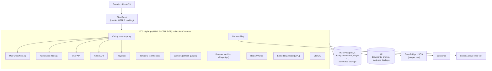

# Cost Plan (Low Budget, Free Where Possible)

Goal: launch on a very small budget using free tiers and small instances, with **the same containers and design** that later scale up. Prices below are approximate on-demand figures for planning only; confirm them with the AWS Pricing Calculator and each provider's pricing page before launch.

## 1. Deployment stages

| Stage | When | Shape | Rough monthly infra cost |
|---|---|---|---|
| **A. Lean launch** | Beta and first users | One ARM EC2 instance running all containers with Docker Compose; small managed PostgreSQL; S3; CloudFront | ≈ $45–90 |
| **B. Growth** | Steady users, more load | 2–3 instances (APIs/web, workers, browser pool) behind a load balancer; larger database with a standby; managed Redis | ≈ $200–400 |
| **C. Scale** | Large user base | Full target design: ECS/Fargate services, Multi-AZ, separate accounts, WAF, Temporal Cloud ([Design/13-Infrastructure-and-Operations.md](Design/13-Infrastructure-and-Operations.md)) | Grows with usage |

Moving between stages changes infrastructure configuration only (Terraform and Compose files), not application code, because every part already runs as a container with external configuration.

## 2. Stage A: lean launch architecture

| Item | Choice | Approx. monthly |
|---|---|---|
| Compute | 1 × EC2 t4g.large (ARM); 1-year savings plan later | $35–50 |
| Database | RDS PostgreSQL db.t4g.micro (or small), single-AZ, 20–50 GB gp3, 7-day backups | $13–30 |
| Storage | S3 (documents, archive, evidence, DB dumps) with lifecycle rules | $1–5 |
| CDN | CloudFront (free tier covers early traffic) | $0 |
| Networking | No NAT gateway (instance in public subnet, locked-down security group); 1 public IPv4 | ≈ $4 |
| DNS | Route 53 hosted zone + domain (yearly domain fee extra) | ≈ $1 |
| Events | EventBridge + SQS (very low volume) | ≈ $0–1 |
| Email | SES (pennies per thousand emails) | ≈ $0–2 |
| Secrets/keys | KMS key + a few Secrets Manager secrets | ≈ $2–4 |
| **Total infra** | | **≈ $45–90** |

New AWS accounts usually get free-tier usage or credits; check the current offer, as it can reduce the first months to near zero.

## 3. Free services used

| Need | Free option |
|---|---|
| Monitoring (logs, traces, metrics, profiles, front end) | Grafana Cloud free tier; self-hosted Grafana stack as fallback |
| Mobile crash reporting | Sentry free plan |
| Product analytics | PostHog free tier (consent-based) |
| Authentication | Keycloak (self-hosted, open source) |
| Workflow engine | Temporal (self-hosted, open source) |
| Embeddings | Open multilingual embedding model on CPU (no API cost) |
| OCR fallback | Tesseract (open source) |
| Push notifications | Expo Push / Firebase Cloud Messaging (free) |
| CI/CD | GitHub Actions free minutes (private repos have a monthly allowance; public repos are free) |
| Mobile builds | EAS free tier (limited builds) or local builds on a developer machine |
| Load testing | k6 (open source) |
| Security scanning | CodeQL, gitleaks, Trivy, OWASP ZAP (free) |
| Design | Figma free plan |

## 4. Paid items that can't be avoided

| Item | Cost | Notes |
|---|---|---|
| Google Play developer account | One-time $25 | Needed for Play Store |
| Apple developer account | $99 per year | Only when you publish to the App Store; the iOS app is built and tested before that |
| Domain name | ≈ $10–15 per year | |
| Claude API | Usage-based | Biggest variable cost (§5) |
| WhatsApp Business messages | Per-message fees for business-initiated messages | Check Meta's current pricing for Bangladesh; push is free, so WhatsApp is reserved for urgent messages by default |
| Agent runs (AIDLC) | Claude usage | Daily agent budgets ([10-AIDLC-Agents.md](10-AIDLC-Agents.md)) |

## 5. AI cost

AI is the largest cost driver. Levers, in order:

1. **Only process what's new.** Extract a posting once; re-extract only changed versions.
2. **Batch API** for nightly bulk extraction (about half price).
3. **Prompt caching** of stable instructions and schemas.
4. **Effort level** set per task (low for classification).
5. **Small outputs**: structured outputs with only the needed fields.
6. **Model choice per task**: the plan uses Claude Opus 5.5 for every task (decision T5). For example, one posting extraction (≈5,000 input and 1,000 output tokens) costs roughly $0.04 with Claude Opus 5.5 ($4 / $20 per million tokens), or roughly $0.001 with Claude Haiku 5.5 ($0.10 / $0.50 per million tokens), before Batch API savings. At 1,000 new postings a day that is roughly $1,200 a month versus $30 a month. Switching high-volume tasks to a smaller model is the Product Owner's decision and must be backed by eval results ([05-AI-Design.md](05-AI-Design.md)).
7. **Budgets**: per-user and platform daily caps with alerts at 80%.

## 6. Cost guardrails

- AWS Budgets with alerts at 50%, 80%, and 100% of the monthly limit.
- Every resource tagged by service and environment.
- Grafana usage kept inside free limits with sampling and log-level rules ([11-Observability.md](11-Observability.md)).
- S3 lifecycle rules: move old raw postings and logs to cheaper storage classes; delete temporary files.
- Dev and staging run on the same small instance type and are stopped outside working hours (scheduled stop/start), or run locally in Docker.
- The Capacity/Cost agent produces a weekly cost and growth report with savings proposals.
