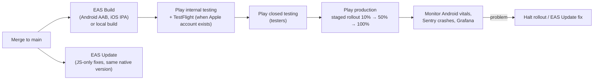

# Mobile App: Android and iOS, Play Store Release

## 1. Device support ("all phones")

| Topic | Plan |
|---|---|
| Platforms | One Expo React Native codebase for Android and iOS |
| OS versions | As old as the chosen Expo SDK supports (decided in Sprint 0, requirements decision 59) through the newest |
| Screen sizes | 320 pt wide small phones to large phones, foldables, and tablets; layouts adapt (single column on phones, two panes on tablets) |
| Low-end phones | Hermes engine, lazy-loaded screens, image compression, list virtualization, offline cache; tested on a low-memory Android device |
| Text size | Respects system font scaling up to 200% without broken layouts |
| Network | Works on slow 3G/4G; retries; offline viewing (requirements §53.7) |
| App size | Target under 30 MB download for Android (App Bundle splits per device) |
| Theme and language | Active light theme chosen by admin (Sober default, Horizon, Orchid), applied at launch and on change; English (v1) |

## 2. Build and release pipeline

## 3. Google Play checklist

Policies change; the DevOps/Release and Compliance agents re-check current Google Play requirements before each release.

| # | Item | Notes |
|---|---|---|
| 1 | Google Play Console developer account | One-time $25; identity verification |
| 2 | Testing before production | New personal developer accounts must run a closed test with a minimum number of testers for a minimum number of days before production access (currently 12 testers for 14 days; confirm at the time). Plan beta testers early |
| 3 | Target API level | Build with the target Android API level Google currently requires for new apps and updates |
| 4 | App format and signing | Android App Bundle (AAB); Play App Signing enabled; upload key stored safely (EAS credentials or secure vault) |
| 5 | Package name | Final reverse-domain name chosen once (for example `com.<company>.careerpilot`); can't be changed later |
| 6 | Store listing | App name, short and full description, 512 × 512 icon, 1024 × 500 feature graphic, phone and tablet screenshots, contact email, website; developer credit "Team Sober" (https://team-sober.com/) |
| 7 | Privacy policy URL | Public page describing data use, AI providers, admin access, retention (requirements §13, §40, §53.5) |
| 8 | Data safety form | Declares data collected (account, profile, documents, contact info, IP address, approximate location, device and app information, sign-in history, push token), purposes (account security, fraud prevention, app functionality), sharing (employers, AI provider, messaging), encryption, deletion. Precise location and contacts are declared only if a feature requesting them is added |
| 8a | Permissions disclosure | Runtime permission prompts only with an in-app explanation first; no silent or background collection of location or contacts (Google Play user-data policy) |
| 9 | Account deletion | In-app deletion (requirements §46.2) **and** a public web link where users can request deletion |
| 10 | Content rating | Complete the questionnaire |
| 11 | Target audience | Adults or 16+/18+ according to decision 48 (minimum age); not designed for children |
| 12 | Permissions | Notifications (Android 13+ runtime permission), camera (photo/signature), Photo Picker for images (avoid broad media permissions), no SMS or call-log permissions |
| 13 | Reviewer access | Test account and instructions in "App access" so reviewers can sign in |
| 14 | Sensitive features | Clear in-app disclosure of automatic applications, consent screens, and controls; financial-feature or payment declarations if payment features are enabled |
| 15 | Ads | Declare "no ads" (unless added later) |
| 16 | Quality | Crash-free and ANR rates within Android vitals thresholds before widening rollout |

## 4. iOS (App Store, when ready)

| Item | Notes |
|---|---|
| Apple Developer Program | $99 per year, required for TestFlight and App Store |
| Building without a Mac | EAS Build in the cloud builds and signs iOS apps |
| Privacy | App Privacy details ("nutrition labels"), privacy manifest, App Tracking Transparency only if tracking is ever added |
| Sign-in | If third-party social sign-in is offered, Sign in with Apple must also be offered |
| Account deletion | In-app account deletion (already required) |
| Review notes | Test account and explanation of automatic applications and consent |

## 5. Mobile security and quality

- Tokens in secure storage; biometric unlock; no secrets in the app bundle.
- Certificate pinning considered for the API domain (with a safe rotation plan).
- Crash reporting (Sentry) with personal data scrubbed; traces linked to backend traces.
- Release notes generated by the Documentation agent; version numbers follow semantic versioning with build numbers incremented automatically.
