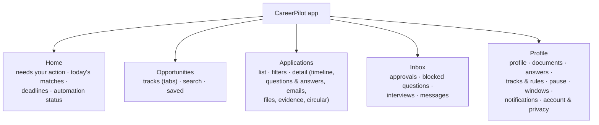
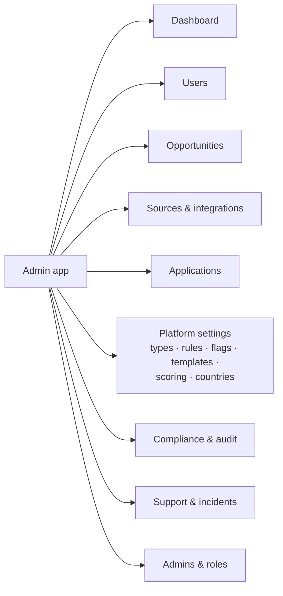
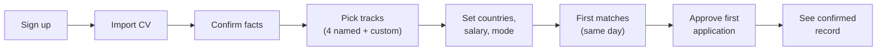

# UX and UI Design Guide (Light Theme, English)

The guide used by the UX/UI Designer and UI Validation agents. Scope for v1: light theme, English, web + Android + iOS + admin. **All screens, flows, and components are designed by the UX/UI Designer agent** following this guide and checked by the UI Validation agent ([10-AIDLC-Agents.md](10-AIDLC-Agents.md)); the Product Owner reviews them at the Inception checkpoint.

## 1. UX principles

1. **Trust through transparency.** Users let the system act for them only if they can see what it will do, what it did, and why. Always show the reason, the evidence, and the status in plain words.
2. **Action first.** Every screen starts with what needs the user now (approvals, blocked questions, deadlines), then progress, then history.
3. **One-tap where safe, deliberate where risky.** Approving a ready package takes one tap. Payments, attestations, automatic rules, and deletion need a clear review step.
4. **Progressive disclosure.** Show the key facts first (role, employer, match, deadline, status); details expand on demand.
5. **Forgiving.** Undo for recent changes, recently deleted area, cancel windows for queued emails, and drafts that never get lost.
6. **Mobile first, works everywhere.** Designed for a one-handed phone first, then expanded for tablets and desktop.
7. **Consistency.** Same words, statuses, icons, and layouts on web, mobile, and admin (single status model, requirements §20.2).
8. **Accessible by default.** WCAG 2.2 AA; readable for non-native English speakers; large touch targets.
9. **Calm, not noisy.** Few, meaningful notifications; quiet hours; no dark patterns.
10. **Honest states.** Never show success without evidence; uncertain is shown as uncertain.

## 2. Users (personas)

| Persona | Needs most |
|---|---|
| Fresh graduate in Bangladesh | Simple onboarding, local and government jobs, guidance on missing documents, low data use |
| Experienced professional seeking remote/international work | Strong filtering (sponsorship, countries, salary), automatic applications, detailed records |
| Master's/PhD applicant | Deadlines and test planning, funding clarity, supervisor outreach, document tracking |
| Government job seeker | Grade filters, circular details, fee and admit-card reminders, Bangla circular reading |
| Administrator | Fast overview, drill-down, safe bulk actions, audit trail |

## 3. Information architecture

### 3.1 Mobile (bottom tabs)

### 3.2 Web (left sidebar, same sections) and admin

## 4. Key journeys

Target: a new user reaches the first recommended matches in under 10 minutes and the first approved application in under 15 minutes.

## 5. Key screens

| Screen | Must show | Primary actions |
|---|---|---|
| **Home** | "Needs your action" cards (approvals, questions, deadlines), today's matches per track, automation status (on/paused, next submission time), recent results | Approve, Answer, Open |
| **Opportunity detail** | Title, organization, location, work type, deadline (with time zone), compensation, match score with reasons, hard-requirement checks (pass/fail/unknown), warnings (fraud, sponsorship not stated), source and "archived copy" link | Apply, Save, Dismiss (with reason), Report |
| **Approval package** | Summary first (where, how, deadline, warnings); sections: answers (editable inline, source shown), cover letter (editable), files (preview), account/fee/consents, data shared; missing items at top | Approve, Edit & approve, Schedule, Reject, Defer |
| **Applications list** | Status chip (text + icon), route, date, next action, deadline | Filter, search, open |
| **Application detail** | Timeline; questions exactly as asked with answers and sources; email thread; exact files; evidence; archived circular; notes and corrections | Add note, correct status, withdraw |
| **Automation rule wizard** | Step by step: scope → filters → materials → limits → schedule → review summary → dry run results | Save draft, Run dry run, Activate |
| **Pause** | Duration presets (1 day, 1 week, 1 month, custom, until I resume), scope, affected approvals | Pause, Extend, End |
| **Onboarding** | Progress indicator, skip for optional steps, readiness indicators | Continue, Skip |
| **Documents** | Versions, approved state, validity dates, which applications used each version | Upload, Approve, Replace |
| **Admin dashboard** | Metric cards, trends, alerts, drill-down tables | Filter, export, act |

## 5a. Profile (the "master" profile)

The profile is the centre of the product. Design goals: complete, fast to edit, trustworthy, beautiful on every device.

| Area | Design |
|---|---|
| Header | Profile photo (tap to view full size with zoom; edit button to replace/crop/remove), name, headline, location, completeness ring, "Preview as application" and "Preview CV" buttons |
| Section navigation | Sticky section index (phone: horizontal chips; tablet/desktop: left column) with completeness per section |
| Sections | Basics · Contact (multiple emails and phones, verified badges, primary marker) · Identity details (masked until revealed) · Addresses · Education · Employment · Projects · Skills and languages · Tests and scores · Certifications · Publications and awards · Links · Referees · Signature · Documents · Preferences |
| Entries | Cards with drag handle, inline edit, overflow menu (duplicate, delete, move up/down) |
| Photo editor | Upload or camera, crop with aspect presets (square, passport 3:4, portal-specific sizes), rotate, background check for formal photos, live preview of required size |
| Signature | Upload or draw on a signature pad (finger/stylus/mouse), auto background removal, crop, preview at portal size |
| Verification | Email/phone verification inline with code entry; clear "verified"/"not verified" states |
| Guidance | "Next best item" card (for example "Add IELTS score to unlock 34 programmes"), expiry warnings, privacy notes for sensitive fields |
| Editing | Autosave with "Saved" indicator, undo toast, validation inline |

## 5b. Image and document viewer

- One shared viewer component on web, admin, and mobile for photos, signatures, certificates, documents, and archived circulars.
- Zoom: pinch and double-tap (touch); scroll wheel, +/− buttons, and keyboard (+, −, 0 to reset) on desktop; zoom range 25%–800%.
- Pan by drag; rotate in 90° steps; fit-to-width and fit-to-screen; full-screen mode; page navigation for multi-page PDFs with thumbnails.
- Download and share (where allowed); version selector for documents; metadata panel (size, type, version, validity).
- Accessible: buttons with labels, focus trap in full-screen, Escape to close, alt text where available.

## 5c. Drag and drop

- Used wherever order matters (requirements §5.5): tracks, profile entries, contacts, documents, locations, reusable answers, dashboard cards, approval queue (custom order), admin ordered lists.
- Visible drag handle (⋮⋮) on each item; on touch devices long-press to start dragging; haptic feedback on mobile.
- Clear drop indicator and auto-scroll near list edges; animation 150–200 ms.
- Keyboard: focus item, Space to pick up, arrow keys to move, Space to drop, Escape to cancel; screen-reader announcements of position.
- Non-drag alternative always present (Move up/Move down, or "Move to position…"), meeting WCAG 2.2 SC 2.5.7.
- Order saves automatically with an Undo toast; where order affects behaviour (track priority, CV order) a short hint explains it.

## 5d. Responsive layout

| Breakpoint | Width | Layout |
|---|---|---|
| XS (small phone) | < 360 px | Single column, compact spacing, bottom tabs |
| SM (phone) | 360–599 px | Single column, bottom tabs, bottom sheets for actions |
| MD (large phone/small tablet, foldable) | 600–839 px | Single column with wider cards; optional two-pane in landscape |
| LG (tablet/laptop) | 840–1199 px | Two panes (list + detail), side navigation rail |
| XL (desktop) | ≥ 1200 px | Sidebar navigation, list + detail + context panel; max content width for readability |

- Layouts adapt (reflow, collapse, change navigation), never just shrink.
- Touch targets ≥ 44 pt / 48 dp; text scales with system font size up to 200%.
- Images use responsive sizes; tables become cards on small screens.
- Every screen is checked at each breakpoint by the UI Validation agent (visual regression on all five sizes).

## 6. Interaction patterns

| Pattern | Rule |
|---|---|
| Status | Chip with icon + text + tooltip explanation; never colour alone |
| Loading | Skeletons for content; progress for uploads and long tasks; never block the whole screen without a reason |
| Empty states | Explain why it's empty and what to do (for example "No matches above 80% today. Lower the threshold or add skills.") |
| Errors | Say what happened, why (if known), and how to fix it; keep user input; offer retry |
| Confirmation | Only for irreversible or external actions; state the consequence ("This sends your application to Acme Ltd.") |
| Undo | Toast with Undo for reversible changes (dismiss, delete to recently deleted, edits) |
| Offline | Banner "You're offline. Changes will be sent when you're back online."; pending items marked |
| Notifications | Each notification opens exactly the related item; quick actions where safe |
| Forms | Labels above fields, helpful defaults, inline validation on blur, error summary on submit, keyboard types matching data (email, phone, number) |
| Dates and money | Always with time zone and currency; relative dates ("in 3 days") plus exact date |
| Tables (web/admin) | Sticky headers, column chooser, saved filters, bulk actions with preview |

## 7. Visual design (light theme)

| Token group | Values (initial) |
|---|---|
| Primary | Blue 600 `#2563EB` (actions, links), hover 700 `#1D4ED8` |
| Neutrals | Background `#FFFFFF`, surface `#F8FAFC`, border `#E2E8F0`, text primary `#0F172A`, text secondary `#475569` |
| Semantic | Success `#15803D`, warning `#B45309`, danger `#B91C1C`, info `#0369A1` (all meet AA contrast on white for text) |
| Typography | Inter for UI text; Noto Sans Bengali for Bangla content inside circulars and names; sizes 12/14/16/18/20/24/30; body 16 on mobile |
| Spacing | 4-point grid (4, 8, 12, 16, 24, 32, 48) |
| Radius | 8 (controls), 12 (cards) |
| Elevation | Subtle shadows on cards and sheets only |
| Icons | Lucide icon set, 20/24 px, always with a label for actions |
| Motion | 150–250 ms ease-out; respects "reduce motion" |

Tokens live in `packages/ui-tokens` and feed both Tailwind (web, admin) and NativeWind (mobile). Dark theme tokens can be added later without component changes.

## 8. Writing style

- Plain, short English; sentence case; active voice.
- Specific button labels ("Approve and send", not "OK").
- Explain automation in user terms ("We'll apply at 12:00 a.m. using CV v3 and your saved answers.").
- No jargon, no blame in error messages.

## 9. Validation and research

- Heuristic review (Nielsen's 10 heuristics) of every new screen by the UI Validation agent.
- Usability tests with 5 users per persona before beta (remote, task-based).
- Metrics: task success rate, time to first application, approval completion time, System Usability Scale (target ≥ 80), drop-off per onboarding step (PostHog funnels).
