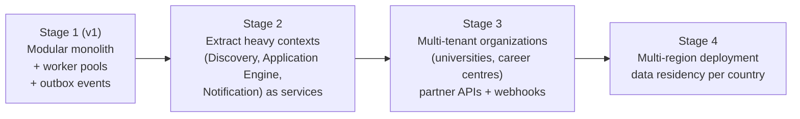

# Architecture Principles and Quality Attributes

## 1. Architecture drivers

The requirements put unusual weight on a few qualities. These drive every design decision:

| Driver | Why it matters | Requirement sections |
|---|---|---|
| **Accuracy and evidence** | Every recommendation and system action must be recorded exactly once; external outcomes shown only with evidence | 20.2, 28, 52 |
| **Safe external actions** | Submissions, emails, payments must never be duplicated, fabricated, or done without authorization | 10, 23, 27, 37, 38 |
| **Privacy and security** | Sensitive identity data, documents, and portal credentials | 13, 40, 41, 43, 53.5 |
| **Extensibility** | New sources, portals, countries, opportunity types, channels, languages, and AI tasks will keep arriving | 7.1, 26.3, 33, 34, 35 |
| **Long-running automation** | Approvals wait days, submissions run at 12:00 a.m., pauses last months | 27, 37, 47, 49 |
| **Multi-platform** | Web, Android, iOS, and admin from one backend | 53 |
| **Growth** | More users, sources, countries, and possibly organizations (universities, career centres) | — |

## 2. Principles

1. **Domain first.** The system is split by business capability (bounded contexts), not by technical layer. Each context owns its data and rules. See [03-Domain-Model.md](03-Domain-Model.md).
2. **Modular monolith first, services when earned.** One deployable backend codebase with strict module boundaries. A module becomes a separate service only when it needs independent scaling, release cadence, or team ownership (see §4).
3. **Hexagonal (ports and adapters).** Domain logic never depends on frameworks, databases, or vendors. Every external system sits behind a port, so it can be replaced. See [04-Component-Design.md](04-Component-Design.md).
4. **Everything external is a plugin.** Sources, application routes, notification channels, AI tasks, document transformers, country rules, and payment trackers implement published interfaces and are registered, configured, and switched on from the admin app. See [05-Extensibility-Framework.md](05-Extensibility-Framework.md).
5. **Configuration and metadata over code.** Opportunity types, their fields, forms, filters, rules, limits, and templates are data (versioned) wherever possible, so most growth needs no code release.
6. **Safeguards live in the core, not in plugins.** Pre-submission checks, precedence, user-only steps, caps, and the emergency stop run in the core pipeline around every plugin. A plugin cannot skip them.
7. **Orchestrate long work durably.** Multi-step, long-running, or external work runs as durable workflows (Temporal) with explicit compensation and "outcome unknown" handling.
8. **Events for integration.** Contexts communicate through versioned domain events (transactional outbox). Synchronous calls between contexts are limited to queries through public module interfaces. See [10-Event-Architecture.md](10-Event-Architecture.md).
9. **API-first and contract-tested.** The OpenAPI contract is the product boundary for all clients. See [09-API-Design.md](09-API-Design.md).
10. **Immutable facts, append-only history.** Records of what happened are never edited; corrections are new facts. Audit is a first-class capability.
11. **Secure and private by design and by default.** Least privilege, encryption everywhere, data minimization, tenant and owner isolation at several layers. See [12-Security-Architecture.md](12-Security-Architecture.md).
12. **Observable by default.** Every request, workflow, event, and AI call carries trace IDs; every external action has a measurable outcome.
13. **Design for failure.** Sources, portals, AI providers, and messaging channels will fail. Timeouts, retries with backoff and jitter, circuit breakers, bulkheads, and dead-letter queues everywhere.
14. **Tenant-ready from day one.** Every row carries `tenant_id` (one default tenant in version 1), so organizations can be added later without a data migration.
15. **Decisions are recorded.** Significant choices become ADRs ([14-ADR-Log.md](14-ADR-Log.md)).

## 3. Quality attribute scenarios

Targets are proposals to confirm in Sprint 0 (requirements Section 54, item 24).

| Quality | Scenario | Target |
|---|---|---|
| **Accuracy** | Every external action and recommendation produces exactly one record | 100%, verified by daily reconciliation |
| **Safety** | A crash during submission never produces a duplicate submission | 0 duplicates; uncertain outcomes go to verification |
| **Availability** | User API and admin API | 99.9% monthly |
| **Timeliness** | Daily digest delivered after the user's scheduled time | 99% within 15 minutes |
| **Timeliness** | Scheduled submission starts after its window opens | 99% within 10 minutes |
| **Performance** | Read endpoints (dashboard, lists, details) | p95 < 300 ms at the API |
| **Performance** | Mobile app cold start to dashboard | < 2.5 s on a mid-range Android phone |
| **Scalability** | Growth in users and sources | Linear horizontal scaling of APIs and workers; no redesign up to 1M users and 10M opportunities |
| **Extensibility** | Add a new source connector or notification channel | No change to core modules; deployed behind a feature flag |
| **Extensibility** | Add a new opportunity type or field | Configuration only (no code release) for fields, filters, and forms |
| **Security** | Secrets exposure | Secrets never returned by any API or written to logs |
| **Privacy** | Data export / deletion request | Completed within 30 days (legal maximum varies); automated in-app |
| **Recoverability** | Data loss after a regional failure | RPO ≤ 15 minutes, RTO ≤ 4 hours |
| **Maintainability** | Module boundaries | Enforced in CI (no forbidden imports) |
| **Observability** | Find the cause of a failed application | All steps traceable from one application ID in < 5 minutes |
| **Accessibility** | Web and mobile | WCAG 2.2 AA |
| **Cost** | AI and messaging spend | Per-user and platform budgets with alerts at 80% |

## 4. Evolution path

Triggers for moving to the next stage:

| Trigger | Action |
|---|---|
| A context needs different scaling or release speed, or a separate team owns it | Extract it as a service; it already communicates through events and a published interface |
| Event volume exceeds what the managed bus handles comfortably | Move the bus to Kafka (Amazon MSK); event contracts stay the same |
| Organizations become customers | Turn on multi-tenant features; `tenant_id` already exists everywhere |
| Data-residency law requires local storage | Deploy a region cell; tenants and users are pinned to a region |
| Search needs exceed PostgreSQL full-text search | Add OpenSearch as a projection fed by events |
