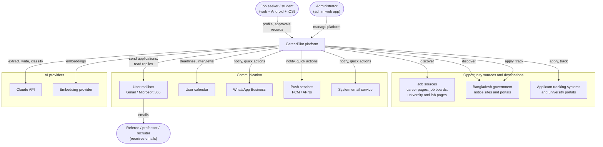
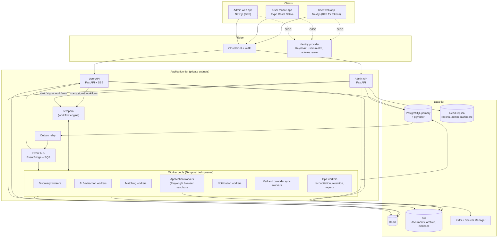

# C4 Level 1 and Level 2: System Context and Containers

The C4 model describes the system at four zoom levels: Context (L1), Containers (L2), Components (L3, see [04-Component-Design.md](04-Component-Design.md)), and Code (L4, interfaces in the same document).

## 1. Level 1: System context

## 2. Level 2: Containers

## 3. Container catalogue

At launch (lean stage, [../12-Cost-Plan.md](../12-Cost-Plan.md)) all application containers, Keycloak, Temporal, and Redis run on one instance; the containers and their responsibilities are the same.

| Container | Technology | Responsibility | Scales by | Notes |
|---|---|---|---|---|
| User web app | Next.js, TypeScript | All user features in a browser; server side acts as a Backend-for-Frontend that keeps tokens in httpOnly cookies | Stateless instances | [11-Frontend-Architecture.md](11-Frontend-Architecture.md) |
| User mobile app | Expo React Native | All user features on Android and iOS; push actions; offline viewing | Devices | Tokens in secure storage |
| Admin web app | Next.js, TypeScript | Admin dashboard and management | Stateless instances | Separate domain; admin realm only |
| Identity provider | Keycloak | Sign-in, MFA, passkeys, sessions, two realms | Clustered | Admin realm requires MFA |
| User API | Python FastAPI | REST API for web and mobile; real-time updates via Server-Sent Events | CPU / requests | Owner-scoped access only |
| Admin API | Python FastAPI (same codebase, different entry point) | REST API for admin app | CPU / requests | Separate network path and database role |
| Temporal | Temporal Cloud or self-hosted | Durable workflows, timers, signals, retries | Managed | Orchestrates all long-running work |
| Discovery workers | Python | Run source connectors, store raw snapshots | Task-queue backlog | Rate limits per source |
| AI / extraction workers | Python + Anthropic SDK | Extraction, writing, classification, claim checks, embeddings | Backlog + AI budget | Batch API for nightly work |
| Matching workers | Python | Hard filters, scoring, recommendations | Backlog | Deterministic, versioned scoring |
| Application workers | Python + Playwright | Fill and submit forms, send emails, collect evidence | Browser pool size | Isolated container per session |
| Notification workers | Python | Push, WhatsApp, email, digests, reports | Backlog | Fallback channels |
| Sync workers | Python | Mailbox and calendar sync | Connected accounts | Minimum OAuth scopes |
| Ops workers | Python | Reconciliation, retention, exports, account deletion, materialized views | Schedule | Read replica where possible |
| Outbox relay | Python | Publishes committed outbox events to the bus | Single active + standby | Guarantees no lost events |
| Event bus | EventBridge + SQS (DLQ per consumer) | Asynchronous integration between contexts | Managed | Replaceable by Kafka later |
| PostgreSQL | Amazon RDS | System of record; schemas per context | Vertical + read replicas; partitioning | Row-level security |
| Redis | ElastiCache | Cache, rate limits, short locks | Cluster | Never the source of truth |
| S3 | Amazon S3 | Documents, circular archive, evidence, exports | Managed | Versioning, Object Lock for evidence |
| KMS / Secrets Manager | AWS | Encryption keys, app secrets | Managed | Envelope encryption for credentials |
