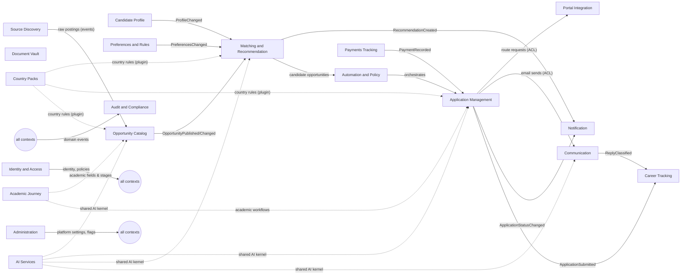

# Domain Model (Domain-Driven Design)

## 1. Bounded contexts

| # | Context | Type | Owns | Requirement sections |
|---|---|---|---|---|
| 1 | Identity and Access | Generic | Users, admins, roles, policies, sessions, devices, consents | 13, 41, 53.2 |
| 2 | Candidate Profile | Core | Profile facts, education, employment, tests, identity details, referees, links, change history | 5.1, 19.3, 35.1, 46 |
| 3 | Document Vault | Supporting | Documents, versions, videos, derived files, validation results | 19, 32.2 |
| 4 | Preferences and Rules | Core | Tracks, filters, excluded countries, compensation rules, submission windows, pauses, automatic rules, reusable answers | 5.2, 5.3, 6, 10.1, 47–49, 51 |
| 5 | Source Discovery | Supporting | Source registry, connector configs, search cycles, raw snapshots | 7.1, 7.2, 18 |
| 6 | Opportunity Catalog | Core | Opportunities, versions (archive), fields with evidence, duplicates, fraud flags, opportunity types | 7.3–7.6, 42, 50 |
| 7 | Matching and Recommendation | Core | Eligibility results, scores, explanations, recommendations, feedback, scoring models | 6.1, 22, 52.2 |
| 8 | Application Management | Core | Applications, status model, approval packages, approvals, submission records, questions and answers, evidence | 10, 20, 28, 37 |
| 9 | Automation and Policy | Core | Pipeline orchestration, precedence, caps, pre-submission checks, emergency stop, reconciliation | 23, 27, 38, 39, 52.3 |
| 10 | Portal Integration | Supporting | Route adapters, portal accounts, encrypted credentials | 10.5, 29, 30 |
| 11 | Communication | Supporting | User mailbox send/read, threads, calendar sync | 10.2, 11.4, 31 |
| 12 | Notification | Generic | Channels, templates, deliveries, digests, reports, quiet hours, notification actions | 11.3, 28.4, 36 |
| 13 | Academic Journey | Core | Programs, tests and scores, referees per application, supervisor outreach, decisions | 9, 33 |
| 14 | Country Packs (Bangladesh first) | Supporting | Country-specific rules: government stages, age rules, quotas, formats, holidays | 8.4, 35 |
| 15 | Career Tracking | Supporting | Assessments, interviews, offers, contacts, insights | 11.5, 34 |
| 16 | Payments Tracking | Supporting | Fee rules, payment records, receipts | 10.10 |
| 17 | Audit and Compliance | Generic | Audit events, data requests (export/deletion), retention | 13, 24.3, 46.2 |
| 18 | Administration | Supporting | Platform settings, feature flags, support tickets, incidents, dashboards | 24, 44, 53 |
| 19 | AI Services | Generic (shared kernel for AI) | Prompt registry, AI task runs, evals, cost tracking | AI design |

**Core** contexts are where CareerPilot differs from other products and get the most design attention. **Supporting** contexts are specific to us but simpler. **Generic** contexts solve common problems with standard patterns or products.

## 2. Context map

Relationship patterns:

- **Anti-corruption layers (ACL)** wrap every external system (portals, mail providers, sources, AI providers) so their models never leak into the domain.
- **Published language:** domain events with versioned schemas ([10-Event-Architecture.md](10-Event-Architecture.md)).
- **Customer/supplier:** Matching (customer) depends on the Opportunity Catalog and Profile (suppliers) through events and query interfaces.
- **Shared kernel:** small shared types (IDs, Money, DateRange, CountryCode, LocalizedText, Evidence, Confidence) in `careerpilot.shared`.

## 3. Aggregates and invariants

| Context | Aggregate (root) | Key invariants |
|---|---|---|
| Candidate Profile | `CandidateProfile` | A fact is user-provided, extracted-unconfirmed, or verified; unknown stays unknown; every change creates a history entry |
| Document Vault | `Document` (versions inside) | An approved version is never silently replaced; originals are never modified |
| Preferences | `Track` | Track settings are independent; limits within platform limits |
| Preferences | `AutoRule` (versions inside) | Changing an active rule creates a new version; material changes need re-approval; expiry date required |
| Preferences | `Pause` | Overlapping pauses merge by scope; a pause never deletes data |
| Opportunity Catalog | `Opportunity` (versions, source links, fields) | Every version is archived with a hash; extracted fields carry evidence and confidence; never mark "new" only because a URL changed |
| Matching | `Recommendation` | Created once per opportunity/track/day; stores score, explanation, model version, archived version reference |
| Application Management | `Application` | At most one active application per opening per user across routes; status transitions follow the state machine ([07-State-Machines.md](07-State-Machines.md)); "Confirmed" only with evidence |
| Application Management | `ApprovalPackage` | Approval covers exactly the shown content; expires; edits scoped (this application, reusable answer, profile) |
| Application Management | `QuestionGroup` | Questions join a group only with matching meaning, timeframe, and jurisdiction |
| Portal Integration | `PortalAccount` | Credential stored only encrypted; never returned |
| Payments | `Payment` | Within rule limits; complete only with provider/portal confirmation |
| Audit | `AuditEvent` | Append-only; hash-chained |

## 4. Domain events (summary)

Full catalogue with producers, consumers, and schemas: [10-Event-Architecture.md](10-Event-Architecture.md). The most important:

`ProfileFactChanged`, `DocumentVersionApproved`, `PreferencesChanged`, `AutoRuleActivated`, `PauseStarted`, `PauseEnded`, `SearchCycleCompleted`, `OpportunityPublished`, `OpportunityChanged`, `OpportunityClosed`, `FraudFlagRaised`, `RecommendationCreated`, `ApplicationCreated`, `ApprovalRequested`, `ApplicationApproved`, `ApplicationSubmitted`, `SubmissionConfirmed`, `SubmissionFailed`, `OutcomeUnknown`, `ManualActionRequired`, `OutcomeStatusChanged`, `EmailReplyClassified`, `PaymentRecorded`, `EmergencyStopActivated`, `AccountDeletionRequested`, `AdminAccessedSensitiveData`.

## 5. Ubiquitous language

Terms follow requirements Section 3 and the status model in Section 20.2. Code, API fields, UI labels, and events use the same names (for example `submission_status = "submitted_awaiting_confirmation"`, never synonyms).
