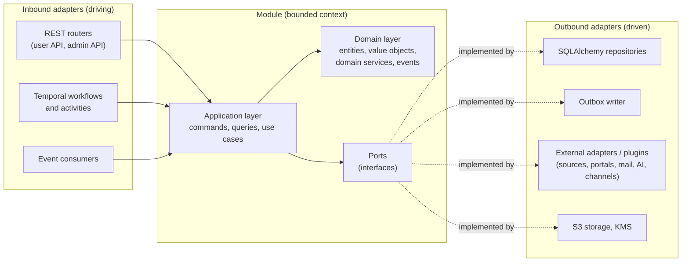
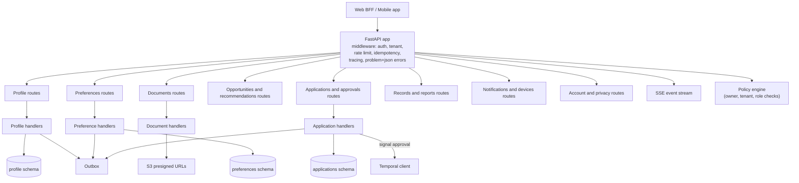
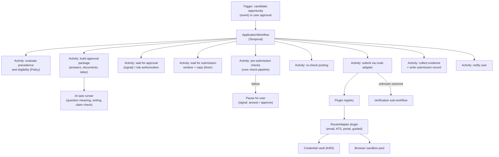
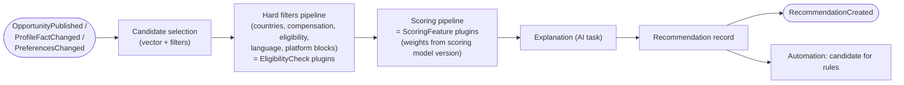

# C4 Level 3 and Level 4: Components and Code Structure

## 1. Hexagonal structure of every module



Dependency rule: `api → application → domain`; adapters depend on ports, never the reverse. The domain layer imports nothing from frameworks. Enforced in CI with `import-linter` contracts.

## 2. Backend code layout

```text
services/
├── core/src/careerpilot/
│   ├── shared/                 # Shared kernel: ids, money, dates, country, localized text,
│   │                           # evidence, errors, result types, clock, pagination
│   ├── platform/               # Cross-cutting: config, db session, unit of work, outbox,
│   │                           # event bus, feature flags, policy engine client, telemetry,
│   │                           # plugin registry, rate limiter, circuit breaker
│   ├── identity/               # Each context has the same internal shape:
│   │   ├── domain/             #   entities.py, value_objects.py, events.py, services.py
│   │   ├── application/        #   commands.py, queries.py, handlers.py, dto.py
│   │   ├── ports/              #   repositories.py, gateways.py
│   │   ├── adapters/           #   sqlalchemy_repo.py, keycloak_gateway.py
│   │   ├── api/                #   user_routes.py, admin_routes.py, schemas.py
│   │   └── module.py           #   public interface other modules may call
│   ├── profile/
│   ├── documents/
│   ├── preferences/
│   ├── discovery/
│   ├── opportunities/
│   ├── matching/
│   ├── applications/
│   ├── automation/
│   ├── portals/
│   ├── communication/
│   ├── notifications/
│   ├── academic/
│   ├── countries/              # Country packs: countries/bd/, countries/<iso>/
│   ├── tracking/
│   ├── payments/
│   ├── audit/
│   ├── administration/
│   └── ai/                     # Prompt registry, task runner, Claude gateway, quality metrics
├── plugins/                    # First-party plugins, each an installable package
│   ├── sources/                #   e.g. source_greenhouse_board, source_bd_gov_notices
│   ├── routes/                 #   e.g. route_email, route_workday, route_bd_gov_portal
│   ├── channels/               #   e.g. channel_whatsapp, channel_expo_push, channel_ses
│   └── transformers/           #   e.g. photo_resize, docx_to_pdf
├── api/                        # Entry points: user_api.py, admin_api.py (compose routers)
└── workers/                    # Entry points per task queue: discovery, ai, matching,
                                # application, notification, sync, ops
```

Other modules may only import a context's `module.py` (public interface) or subscribe to its events.

## 3. Component diagrams

### 3.1 User API



### 3.2 Application engine (Automation + Application Management + Portal Integration)



### 3.3 Discovery and catalog pipeline

```mermaid
flowchart LR
  sch["Temporal schedule<br/>per source"] --> dw["DiscoveryWorkflow"]
  dw --> conn["SourceConnector plugin<br/>(rate limit, circuit breaker)"]
  conn --> raw["Raw snapshot to S3<br/>+ search cycle record"]
  raw --> ev1(["RawPostingFetched"])
  ev1 --> ex["ExtractionWorkflow<br/>(AI task: posting_extraction)"]
  ex --> norm["Normalize to opportunity type<br/>schema (metadata)"]
  norm --> dd["Dedup: similarity +<br/>AI confirm close cases"]
  dd --> fr["Fraud checks:<br/>rules + AI signals"]
  fr --> ver["Create opportunity version<br/>+ archive (Object Lock)"]
  ver --> ev2(["OpportunityPublished / Changed"])
```



### 3.4 Matching engine



## 4. Level 4: key interfaces (code contracts)

These are the stable contracts that plugins implement. Signatures are illustrative Python and will be finalized in Sprint 0.

```python
# careerpilot/platform/plugins.py
class Plugin(Protocol):
    key: str                    # unique, e.g. "route.workday"
    version: str                # semantic version
    config_schema: type[BaseModel]   # validated config, editable in admin app
    def health(self) -> HealthStatus: ...

# Discovery
class SourceConnector(Plugin, Protocol):
    capabilities: SourceCapabilities   # opportunity types, countries, auth needs, terms
    async def list_postings(self, cursor: Cursor | None, ctx: SourceContext) -> PostingPage: ...
    async def fetch_posting(self, ref: PostingRef, ctx: SourceContext) -> RawPosting: ...

# Applying
class RouteAdapter(Plugin, Protocol):
    route_type: RouteType              # email | ats | portal | guided_manual
    def supports(self, destination: ApplicationDestination) -> SupportLevel: ...
    async def discover_form(self, dest: ApplicationDestination, s: Session) -> FormSnapshot: ...
    async def fill(self, form: FormSnapshot, answers: ApprovedAnswers, files: ApprovedFiles, s: Session) -> FillResult: ...
    async def validate(self, s: Session) -> list[ValidationIssue]: ...
    async def submit(self, s: Session, idempotency_key: str) -> SubmitResult: ...      # never retried blindly
    async def confirm(self, s: Session, submit: SubmitResult) -> Evidence | Unknown: ...

# Notifications
class NotificationChannel(Plugin, Protocol):
    channel: str                       # "whatsapp", "push", "email", "sms", ...
    supports_actions: bool             # approve / answer from the notification
    async def send(self, msg: RenderedMessage, to: ChannelAddress) -> DeliveryResult: ...

# Matching
class EligibilityCheck(Plugin, Protocol):
    def evaluate(self, opp: OpportunityView, profile: ProfileView, prefs: PreferencesView) -> CheckResult: ...  # pass | fail | unknown + reason

class ScoringFeature(Plugin, Protocol):
    def score(self, opp: OpportunityView, profile: ProfileView, prefs: PreferencesView) -> FeatureScore: ...  # 0..1 + explanation facts

# Safety (core-owned list; plugins can add checks but cannot remove core checks)
class PreSubmissionCheck(Protocol):
    key: str
    def run(self, pkg: SubmissionCandidate) -> CheckOutcome: ...

# Documents
class DocumentTransformer(Plugin, Protocol):
    def can_transform(self, src: FileMeta, target: FileRequirement) -> bool: ...
    async def transform(self, src: FileRef, target: FileRequirement) -> DerivedFile: ...  # never alters content meaning

# Country packs
class CountryPack(Plugin, Protocol):
    country: CountryCode
    def eligibility_checks(self) -> list[EligibilityCheck]: ...
    def profile_fields(self) -> list[FieldDefinition]: ...      # e.g. SSC/HSC roll, home district
    def opportunity_types(self) -> list[OpportunityTypeDefinition]: ...
    def stages(self) -> list[StageDefinition]: ...              # e.g. admit card, viva
    def holidays(self, year: int) -> list[Holiday]: ...
    def formats(self) -> LocaleFormats: ...                     # phone, address, dates

# AI
class AITask(Protocol[In, Out]):
    key: str                           # "posting_extraction", "claim_check", ...
    prompt_version: str
    output_model: type[Out]            # Pydantic model for structured outputs
    async def run(self, inp: In, ctx: AIContext) -> AIResult[Out]: ...   # records model, prompt version, cost
```

## 5. Cross-cutting components (`platform/`)

| Component | Responsibility |
|---|---|
| Unit of work | One database transaction per command, including outbox rows |
| Outbox + relay | Reliable event publishing ([10-Event-Architecture.md](10-Event-Architecture.md)) |
| Inbox | De-duplicates consumed events (idempotent consumers) |
| Plugin registry | Discovers plugins (Python entry points), validates config, exposes enabled plugins by key and capability |
| Policy engine client | Authorization decisions (RBAC + attribute checks) |
| Feature flags | OpenFeature client; flags managed in admin app |
| Rule engine | Evaluates user and platform rules written in CEL ([05-Extensibility-Framework.md](05-Extensibility-Framework.md)) |
| Resilience | Timeouts, retries with jitter, circuit breakers per source/route/provider, bulkheads (separate worker pools) |
| Rate limiter | Token buckets per source, per route, per user mailbox, per AI budget (Redis) |
| Clock | Injectable clock for testing windows, deadlines, and expiries |
| Telemetry | OpenTelemetry traces, metrics, logs with PII scrubbing |
| Crypto | Envelope encryption helpers (KMS), field-level encryption for sensitive columns |
