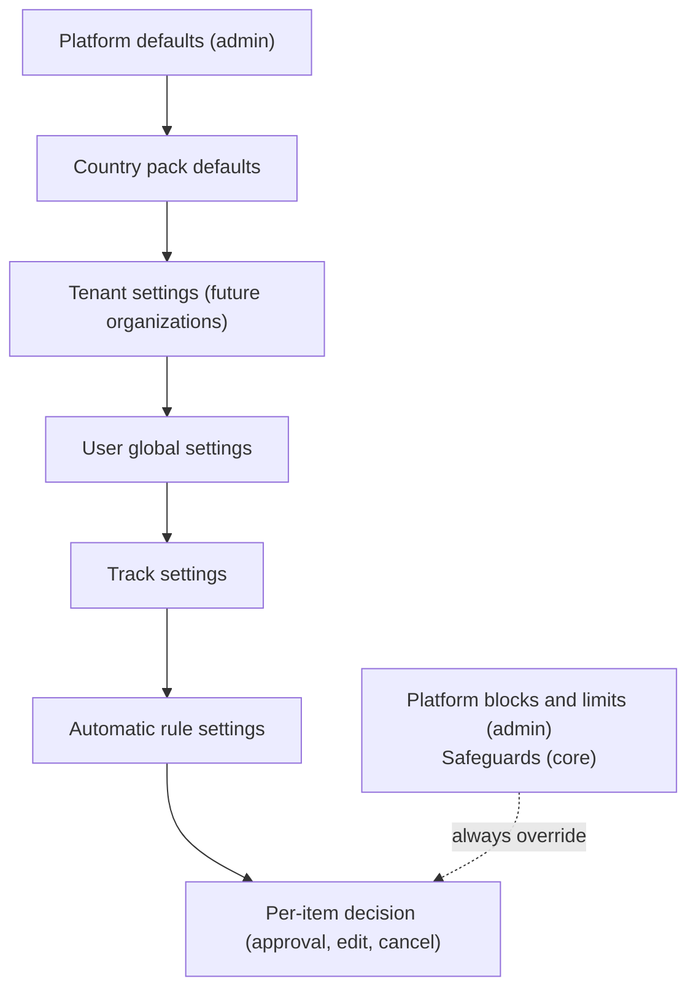

# Extensibility Framework

How CareerPilot grows without rewrites. Most growth should need **configuration only**; the rest should need **a plugin only**; core changes should be rare.

## 1. Extension points

| Extension point | Mechanism | Needs code? | Managed in |
|---|---|---|---|
| New job/academic source | `SourceConnector` plugin | Yes (plugin) | Admin → Sources |
| New source of a known kind (e.g. another company on a supported job board) | Source record with connector + config | No | Admin → Sources |
| New application route (ATS, portal) | `RouteAdapter` plugin | Yes (plugin) | Admin → Routes |
| New notification channel (SMS, Telegram, ...) | `NotificationChannel` plugin | Yes (plugin) | Admin → Channels |
| New opportunity type (fellowship, apprenticeship, competition, ...) | Opportunity type definition (JSON Schema + UI schema) | No | Admin → Opportunity types |
| New field on an opportunity type or profile | Field definition in metadata | No | Admin → Schemas |
| New filter / eligibility rule | CEL expression rule, or `EligibilityCheck` plugin for complex logic | Usually no | Admin → Rules / user settings |
| New scoring factor | `ScoringFeature` plugin + scoring model version with weights | Yes for new factor; no for weights | Admin → Scoring models |
| New country | `CountryPack` plugin (fields, checks, stages, holidays, formats) | Yes (plugin) | Admin → Countries |
| New language | String catalogs + locale formats | No (translation files) | Translation workflow |
| New document conversion | `DocumentTransformer` plugin | Yes (plugin) | Automatic |
| New AI task / prompt change | `AITask` + versioned prompt + eval set | Yes for task; prompt changes via review | Repo + admin (enable/disable, budgets) |
| New notification/email template | Template record (per locale, versioned) | No | Admin → Templates |
| New admin role | Role + policy definitions | No | Admin → Roles |
| New platform limit / default | Platform setting (typed, versioned) | No | Admin → Settings |
| New feature rollout | Feature flag (per user, tenant, %, country) | No | Admin → Flags |
| New payment provider | `PaymentProvider` plugin ([15-Integrations-and-Payments.md](15-Integrations-and-Payments.md)) | Yes (plugin) | Admin → Integrations |
| New external partner integration (future) | Outbound webhooks + partner API scopes | Small | Admin → Integrations |

What is **not** extensible without a requirements change: the status model (20.2), the precedence order (38), user-only steps (27.3), and the core pre-submission checks (27.4). These protect users and stay in the core.

## 2. Plugin system

```mermaid
flowchart LR
  pkg["Plugin package<br/>(entry point declared)"] --> disc["Registry discovers at startup"]
  disc --> val["Validate: interface version,<br/>config schema, capabilities"]
  val --> reg["Registered (disabled)"]
  reg --> cfg["Admin configures + enables<br/>(feature flag, per country/tenant)"]
  cfg --> health["Health checks + circuit breaker"]
  health --> use["Used by core pipelines"]
  use --> mon["Metrics per plugin:<br/>success, latency, errors"]
  mon -->|"error budget exceeded"| auto["Auto-disable + admin alert"]
```



Plugin rules:

- Each plugin declares `key`, `version`, interface version, `config_schema`, and capabilities (for example a route adapter states which portals, file types, and question types it supports).
- Plugins never write directly to other modules' tables; they return results to the core.
- Plugins never perform safeguarded steps on their own: submission is called by the core workflow only after core checks pass; idempotency keys come from the core.
- Plugins run with least privilege: secrets are injected per call; browser plugins run in the sandbox pool.
- Plugins are versioned; the version used is stored on every record they produce (for example the route adapter version in the submission record).
- First-party plugins live in `services/plugins/`; the same mechanism can accept third-party plugins later.

## 3. Metadata-driven opportunity types and fields

Opportunity types are data, not code:

```json
{
  "key": "phd_position",
  "version": 3,
  "label": {"en": "PhD position", "bn": "পিএইচডি পদ"},
  "extends": "academic_opportunity",
  "fields_schema": { "$schema": "https://json-schema.org/draft/2020-12/schema", "type": "object",
    "properties": {
      "supervisor": {"type": "string"},
      "funding_status": {"enum": ["funded", "partially_funded", "unfunded", "not_stated"]},
      "stipend": {"$ref": "#/$defs/money_period"},
      "english_tests": {"type": "array", "items": {"$ref": "#/$defs/test_requirement"}}
    }},
  "ui_schema": {"order": ["supervisor", "funding_status", "stipend", "english_tests"]},
  "filters": ["funding_status", "stipend.amount", "english_tests.type"],
  "evidence_required": ["funding_status", "deadline"],
  "stages": ["application", "interview", "decision", "acceptance"]
}
```

- The extraction AI task receives the type's schema, so new fields are extracted automatically.
- Web, mobile, and admin render details, filters, and edit forms from `fields_schema` + `ui_schema` (dynamic form renderer, [11-Frontend-Architecture.md](11-Frontend-Architecture.md)).
- Values are stored in JSONB validated against the schema version; common fields (title, employer, country, deadline, compensation) stay as typed columns for speed.
- Schema changes are versioned; old opportunities keep the version they were created with.
- Profile fields work the same way (base fields + country-pack and opportunity-type fields).

## 4. Dynamic rules (CEL)

User and platform rules are stored as data and evaluated with **CEL (Common Expression Language)**: safe (no side effects, no loops), fast, typed, and widely used for policy rules.

Examples:

```text
# Compensation hard filter (track: remote)
opp.compensation.period == "year" && opp.compensation.max_usd >= 30000

# Excluded countries (any connected country)
!opp.countries.exists(c, c in prefs.excluded_countries)

# Auto-apply rule scope
opp.type in ["job"] && match.score >= 80 && opp.route.type in ["email", "ats"] && !opp.flags.suspicious
```

- Rules are built through forms in the apps (users never type CEL); the form produces the expression and a human-readable summary.
- Every rule is versioned; records store the rule version used.
- Each rule has a dry-run (requirements Section 27.2) and a validation step that type-checks it against the current opportunity schema.
- Evaluation returns pass / fail / unknown (missing data), keeping "unknown is not satisfied" (requirements Section 38).

## 5. Configuration hierarchy

Settings resolve from most general to most specific; the precedence order in requirements Section 38 decides conflicts.



All settings are typed (schema per setting), versioned, audited, and readable through one configuration service, so every module resolves values the same way.

## 6. Feature flags

- Standard OpenFeature API in backend and front ends; provider chosen in Sprint 0 (self-hosted flag service or database-backed provider).
- Targeting by user, tenant, country, platform (web/Android/iOS), app version, and percentage.
- Every new route adapter, channel, and automation capability ships behind a flag; automatic submission per route has its own flag.
- Flags have an owner and an expiry date; stale flags are cleaned up each release.

## 7. Recipes

### Add a new job source
1. Check source terms; record them in the source registry.
2. If an existing connector fits (for example a known job-board system), create a source record with config. Done.
3. Otherwise create a `SourceConnector` plugin from the template (`/new-connector` project skill), with contract tests against recorded responses.
4. Enable behind a flag for a test tenant; watch plugin metrics; roll out.

### Add a new application route (ATS / portal)
1. Record terms and whether automation is allowed.
2. Create a `RouteAdapter` plugin with mock-portal tests for every corner case in requirements Section 30.
3. Release with automatic mode off; enable approve-each first; enable automatic mode per route after the success-rate threshold.

### Add a new opportunity type
1. Define the type (schema, UI schema, filters, stages) in Admin → Opportunity types.
2. Add eval examples for extraction of the new type.
3. Users can now select it in tracks; forms and filters render automatically.

### Add a new country
1. Create a `CountryPack` (fields, eligibility checks, stages, holidays, formats, opportunity types).
2. Add translations and locale formats if a new language is needed.
3. Add country sources and routes; enable behind a flag.

### Add a new notification channel
1. Implement `NotificationChannel`; declare whether it supports actions.
2. Add templates per locale; add to user channel settings via metadata.
3. Enable behind a flag; fallback rules apply automatically.
