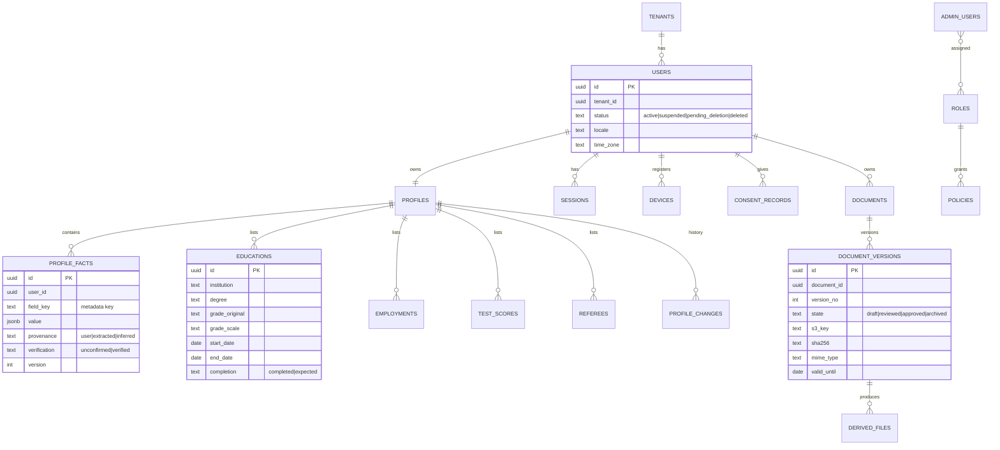
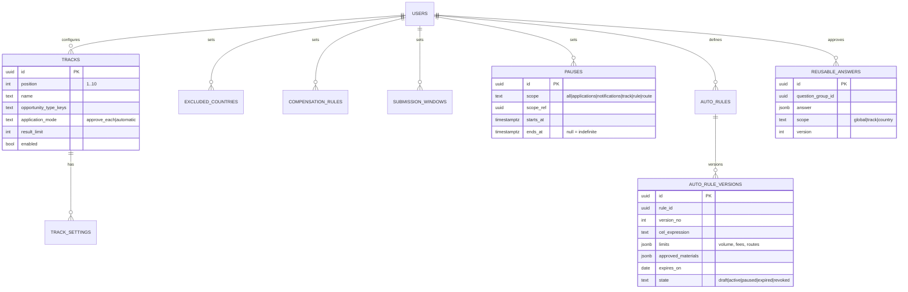
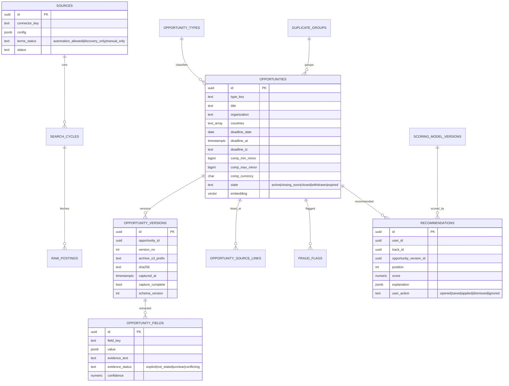
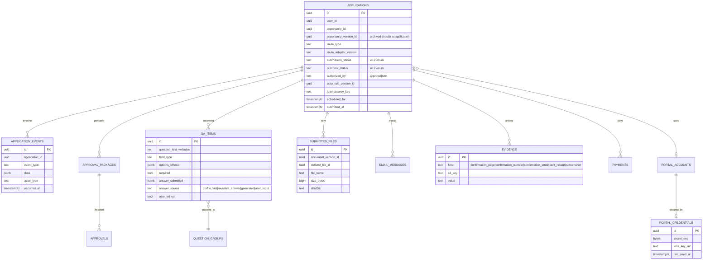
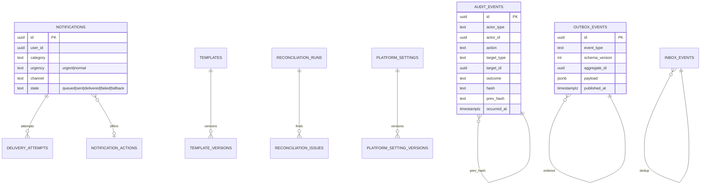

# Data Model (Logical and Physical)

Store choices are in [../04-Data-and-Storage.md](../04-Data-and-Storage.md). This document defines conventions and entity relationships.

## 1. Conventions

| Convention | Rule |
|---|---|
| Schemas | One PostgreSQL schema per bounded context (`identity`, `profile`, `documents`, `preferences`, `discovery`, `opportunities`, `matching`, `applications`, `automation`, `portals`, `communication`, `notifications`, `academic`, `countries`, `tracking`, `payments`, `audit`, `administration`, `ai`) |
| Primary keys | `id uuid` (UUIDv7, time-ordered) |
| Tenancy | Every table has `tenant_id uuid not null` (single default tenant in v1) |
| Ownership | User-owned tables have `user_id uuid not null`; row-level security on `(tenant_id, user_id)` |
| Audit columns | `created_at`, `created_by`, `created_by_type` (`user` / `admin` / `system`), `updated_at`, `updated_by`, `updated_by_type` |
| Concurrency | `version int` for optimistic locking (API uses ETag / If-Match) |
| Soft delete | `deleted_at` + purge job; immutable tables don't soft delete (privacy deletion uses redaction) |
| Time | `timestamptz` in UTC; original time zone in a separate `*_tz` column; date-only values as `date` |
| Money | `amount_minor bigint` + `currency char(3)` (+ `period` where relevant) |
| Enums | PostgreSQL enums only for fixed models (status model); otherwise lookup tables or metadata |
| Flexible attributes | `attributes jsonb` validated against a versioned JSON Schema (`schema_key`, `schema_version`) |
| Sensitive columns | Encrypted at field level (`*_enc bytea`) with key reference; searchable via blind index where needed |
| Cross-context references | By ID only; no foreign keys across schemas (keeps contexts separable) |
| Naming | snake_case, plural table names |

## 2. Identity, profile, documents

## 3. Preferences and rules

## 4. Sources, opportunities, matching

## 5. Applications

## 6. Notifications, audit, administration

## 7. Physical design

| Topic | Design |
|---|---|
| Partitioning | Monthly range partitions for `audit_events`, `application_events`, `notifications`, `delivery_attempts`, `raw_postings`, `recommendations`, `outbox_events` |
| Indexes | B-tree on foreign IDs and states; GIN on JSONB attributes and full-text `tsvector`; HNSW on `embedding`; partial indexes for active items (for example `state = 'active'`) |
| Row-level security | Enabled on all user-owned tables; the user API sets `app.user_id` and `app.tenant_id` per transaction; admin API uses a separate role with audited bypass |
| Read models | Materialized views / projection tables for dashboards and admin metrics, refreshed by events or schedules, served from the read replica |
| Search | PostgreSQL full-text (English + simple Bangla configuration) in v1; OpenSearch projection later |
| Migrations | Alembic, expand-and-contract (add → backfill → switch → remove) so deploys never need downtime |
| Retention | Purge and redaction jobs per data class; Object Lock retention aligned with retention policy |
| Archival | Old partitions moved to cheaper storage (S3, Parquet) for analytics after the retention period, if retained |
