# State Machines

Every stateful entity changes state only through the transitions below. Transitions are enforced in the domain layer, and each transition writes an `application_events` / audit entry and a domain event. Invalid transitions are rejected.

## 1. Application submission status (requirements Section 20.2)

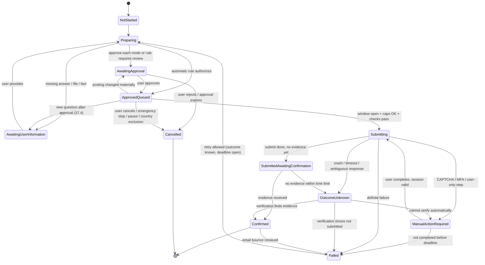

## 2. Application outcome status

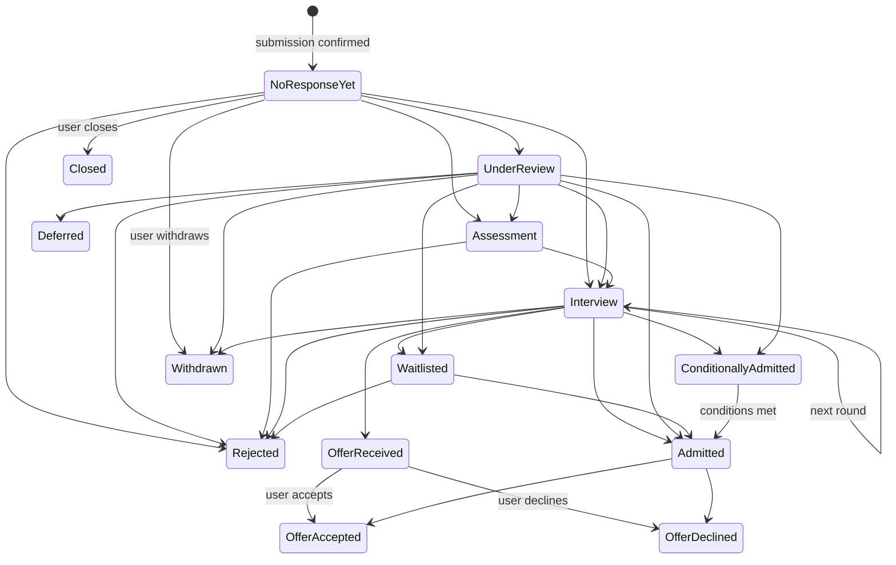

Outcome changes come from evidence (classified emails, portal status) or user entry; each records its source (system-observed, organization-reported, user-entered). Silence never moves to `Rejected`.

## 3. Approval package

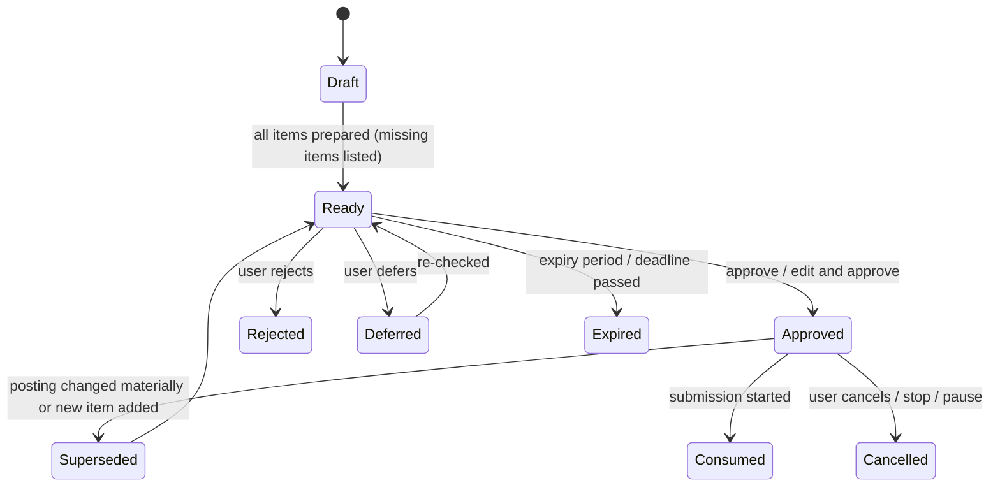

## 4. Opportunity lifecycle

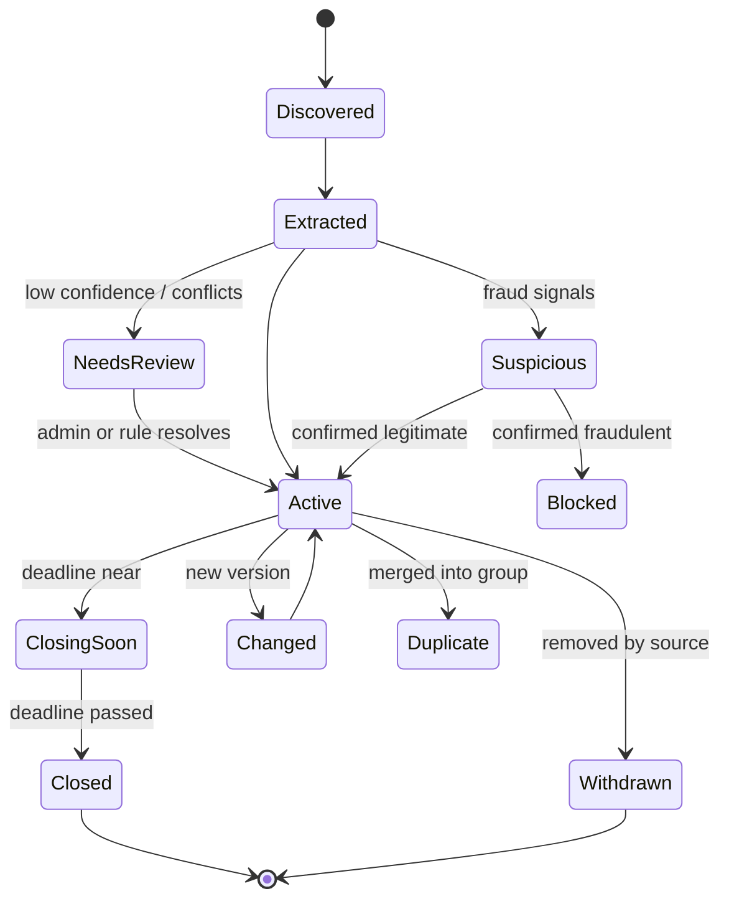

`Withdrawn` and `Closed` opportunities keep their archived versions (requirements Section 50).

## 5. Automatic rule

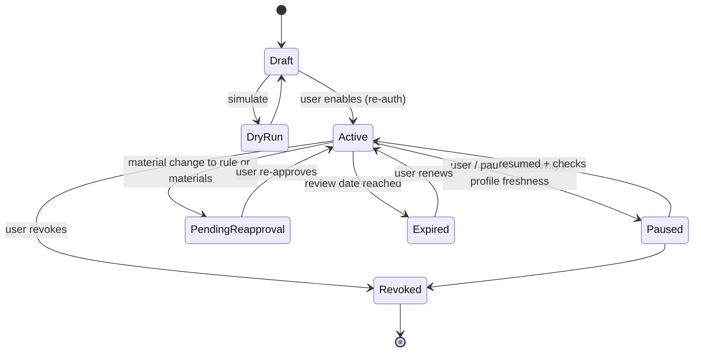

## 6. Pause

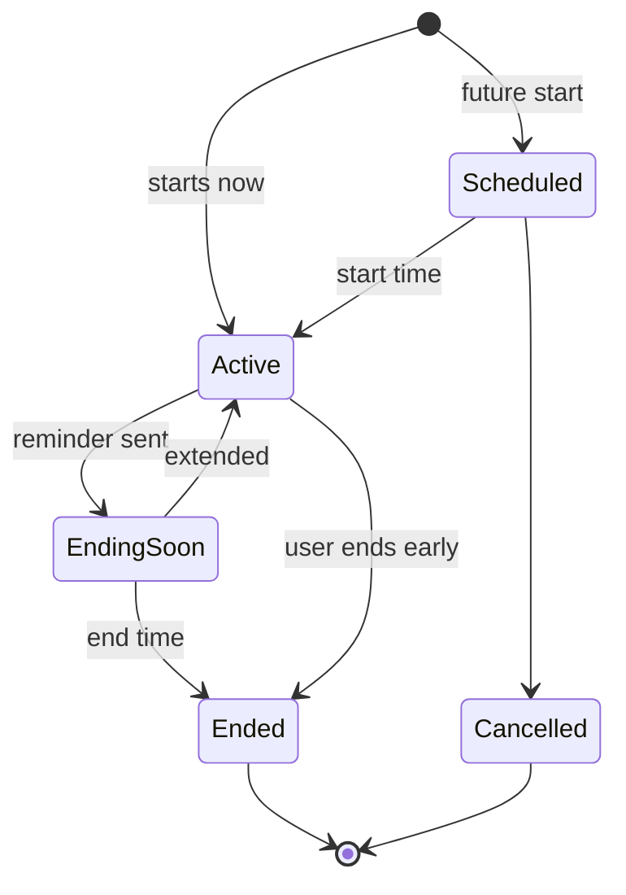

`Active` with no end time = indefinite pause.

## 7. User account

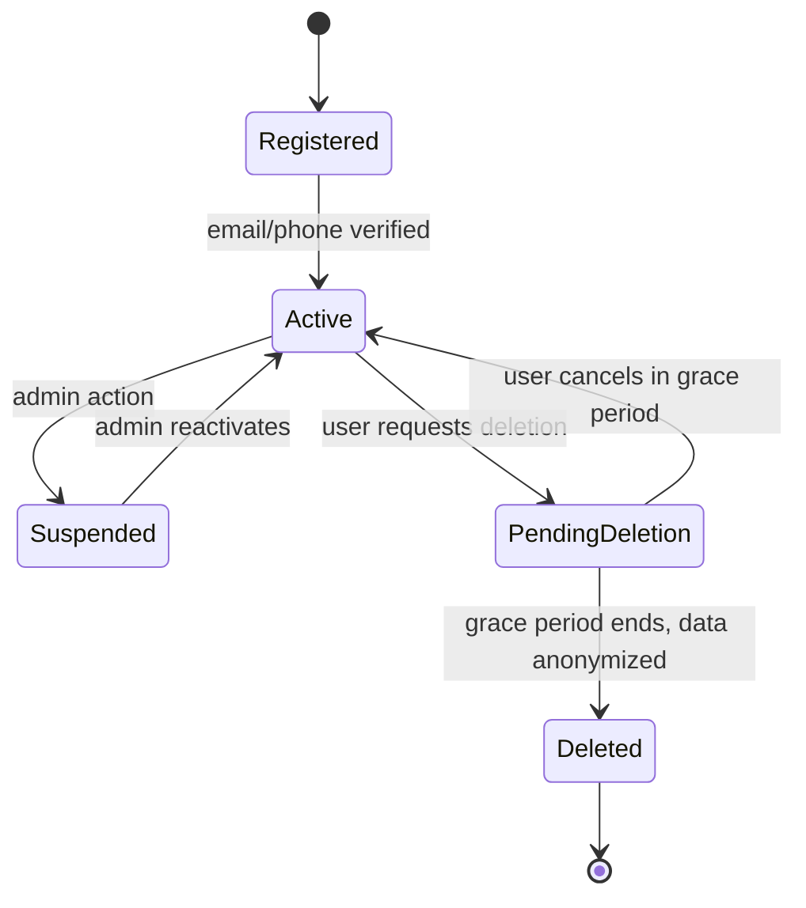

All automation stops immediately on entering `Suspended` or `PendingDeletion`.

## 8. Notification delivery

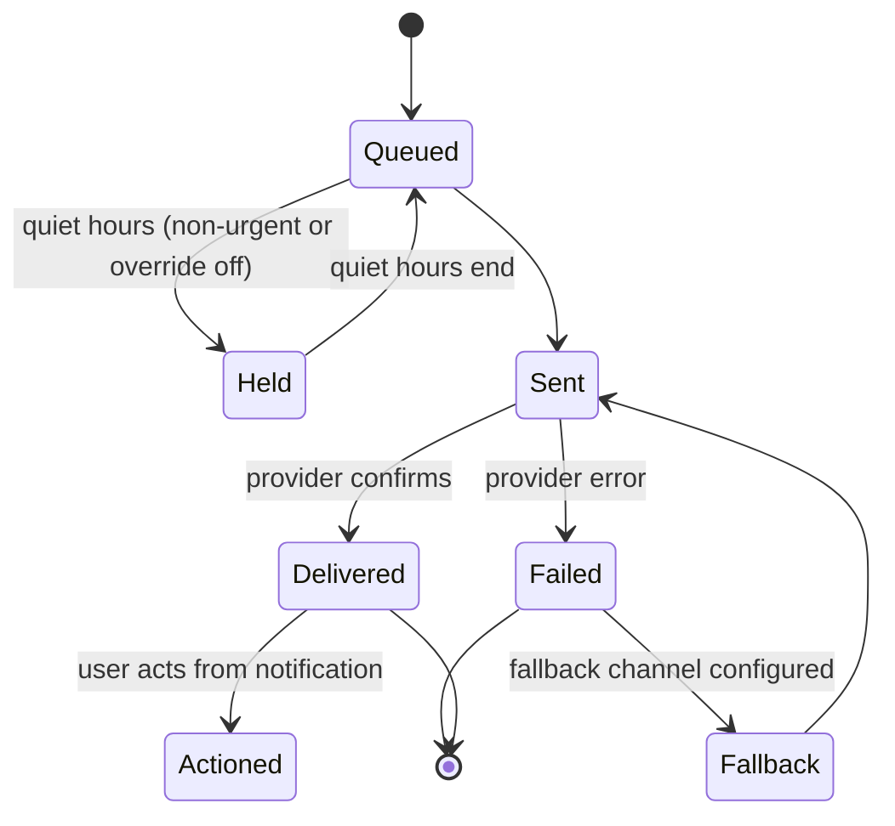

## 9. Search cycle / source check

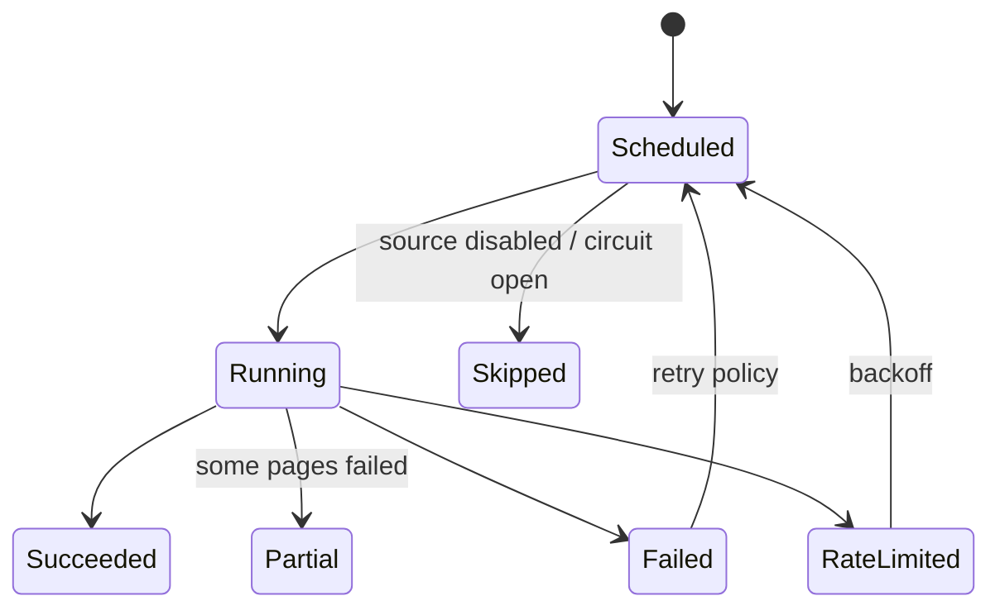

## 10. Payment

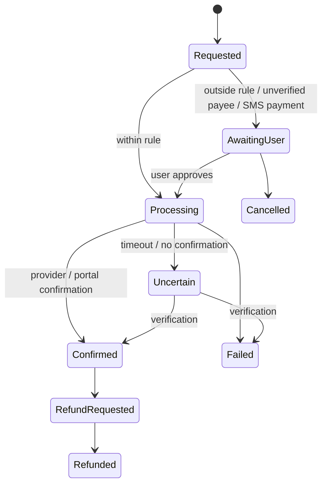

## 11. Document version

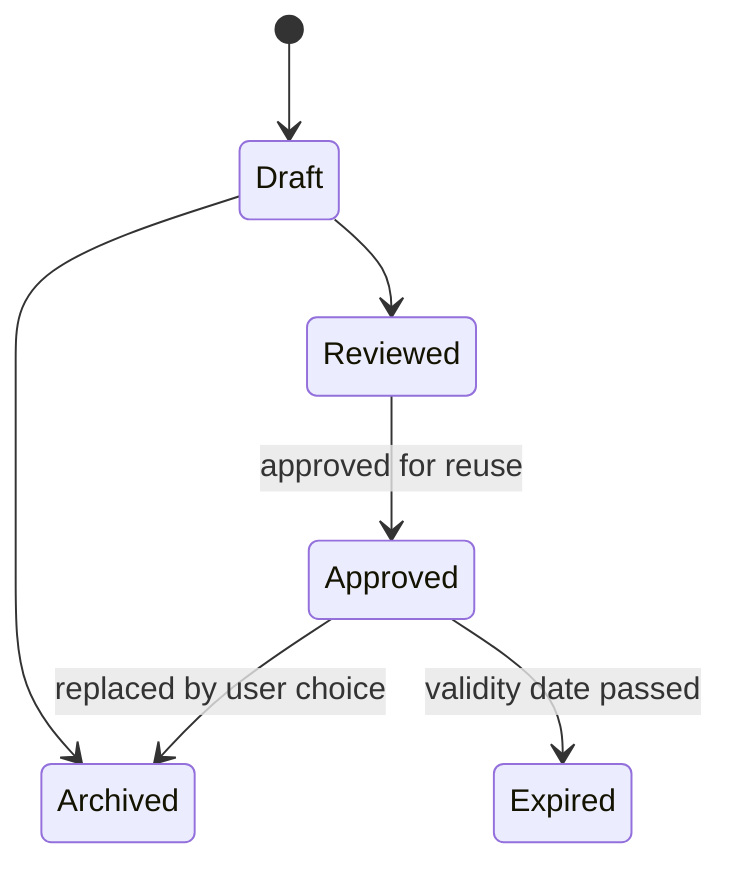

## 12. Portal account

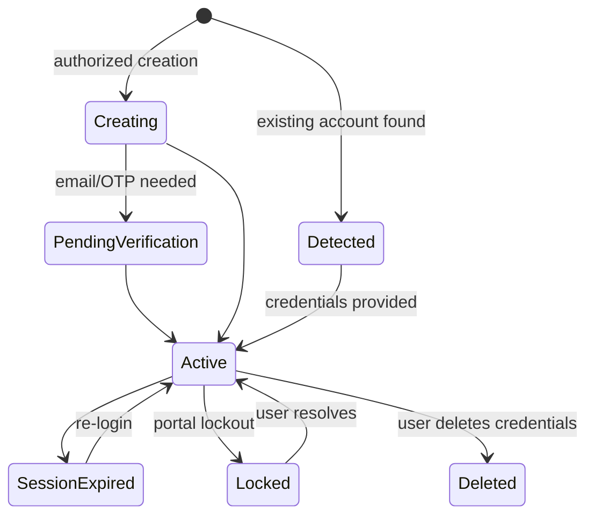

## 13. Government application stages (country pack: Bangladesh)

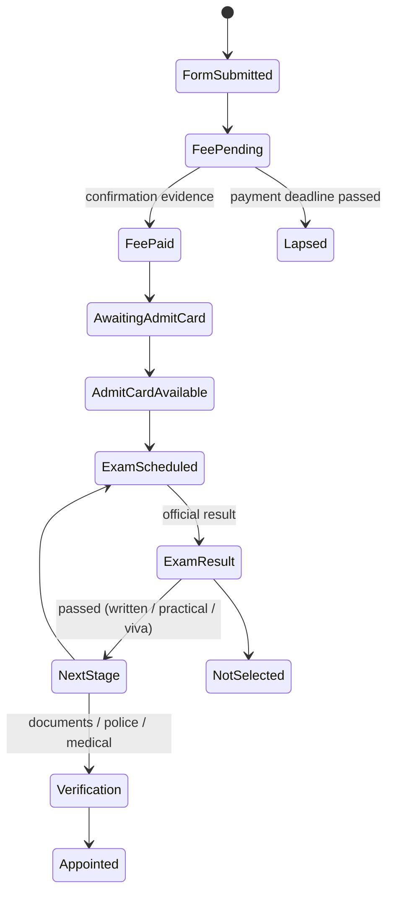

Stage names and order come from the country pack and the circular, so other countries' processes can reuse this mechanism.
