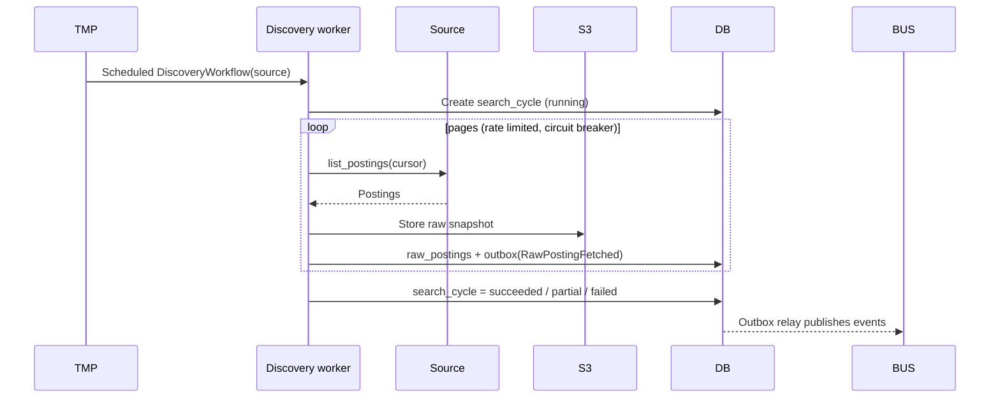
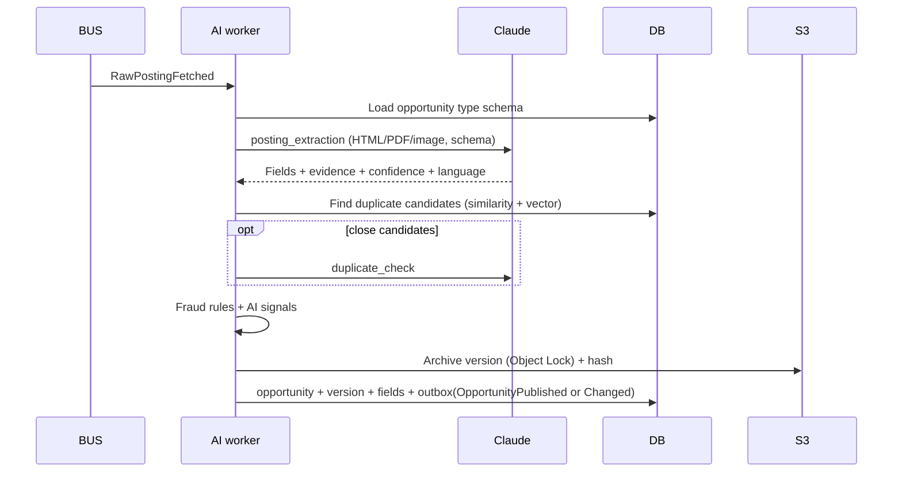
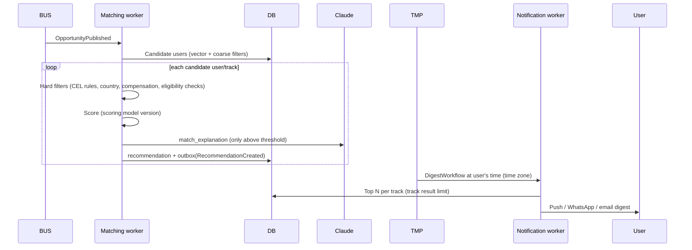
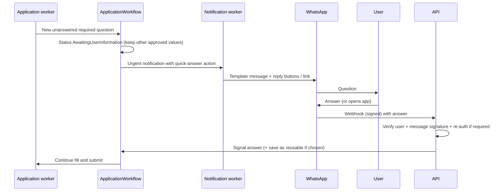
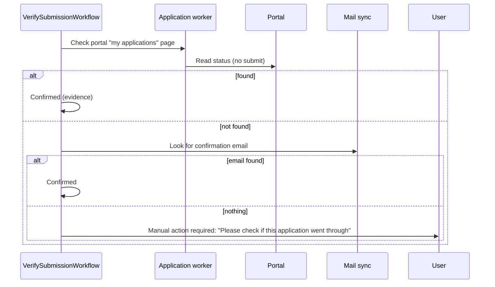
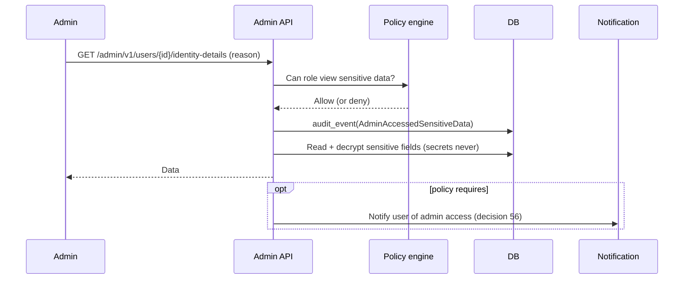

# Sequence Flows

Key runtime flows. Participants: **U** user (web/mobile), **BFF** web server or mobile app, **API** user API, **ADM** admin API, **TMP** Temporal, **W** workers, **DB** PostgreSQL, **S3** object storage, **BUS** event bus, **AI** Claude, **EXT** external system.

## 1. Sign-up, onboarding, and résumé import

```mermaid
sequenceDiagram
  participant U as User
  participant IdP as Keycloak
  participant API
  participant S3
  participant TMP
  participant W as AI worker
  participant AI as Claude
  U->>IdP: Sign up (email/phone, password or passkey, MFA)
  IdP-->>U: Tokens (web: via BFF cookie; mobile: secure store)
  U->>API: POST /v1/onboarding (basics, locale, time zone)
  U->>API: POST /v1/documents/uploads (request presigned URL)
  API-->>U: Presigned URL
  U->>S3: Upload CV
  U->>API: POST /v1/documents/{id}/versions (complete upload)
  API->>TMP: Start ResumeImportWorkflow
  TMP->>W: Scan file (antivirus), extract
  W->>AI: resume_import task (document + profile schema)
  AI-->>W: Structured facts + evidence
  W->>API: Save facts as "extracted, unconfirmed"
  API-->>U: SSE/push: "Review your imported profile"
  U->>API: PATCH /v1/profile/facts (confirm/correct)
```

## 2. Discovery cycle



## 3. Extraction, archive, dedup, fraud



## 4. Matching and daily digest



## 5. Approve-each application (end to end)

```mermaid
sequenceDiagram
  participant U as User
  participant API
  participant TMP as ApplicationWorkflow
  participant W as Application worker
  participant AI as Claude
  participant EXT as Portal
  participant DB
  U->>API: POST /v1/applications {opportunity_id, route}
  API->>DB: application (NotStarted) + idempotency
  API->>TMP: Start ApplicationWorkflow
  TMP->>W: Build approval package
  W->>EXT: discover_form (sandbox)
  W->>AI: question_understanding, writing tasks, claim_check
  W->>DB: approval_package (Ready); status AwaitingApproval
  TMP-->>U: Notify "Approval needed"
  U->>API: POST /v1/approval-packages/{id}/approve {edits, edit_scopes, submit_at}
  API->>DB: approval + edits (this app / reusable answer / profile)
  API->>TMP: Signal approved
  TMP->>TMP: Wait for window, caps, pause checks (timers)
  TMP->>W: Pre-submission checks + re-check posting
  W->>DB: intent record (idempotency key)
  W->>EXT: sign in, fill, upload, submit
  EXT-->>W: Confirmation page / number
  W->>DB: evidence + Q&A + files + status Confirmed + outbox
  TMP-->>U: Notify result
```

## 6. New question after approval, answered from WhatsApp



## 7. Automatic application with window and caps

```mermaid
sequenceDiagram
  participant BUS
  participant TMP as ApplicationWorkflow
  participant P as Policy (precedence, caps, pauses, countries)
  participant W as Application worker
  participant U as User
  BUS->>TMP: RecommendationCreated (rule candidate)
  TMP->>P: Evaluate rule version (CEL) + precedence (38)
  alt blocked / unknown hard requirement / suspicious
    P-->>TMP: Stop with reason
    TMP-->>U: Listed in "not applied" with reason
  else allowed
    TMP->>TMP: Reserve cap slot; wait for submission window
    TMP->>W: Prepare + checks + re-check posting
    W->>W: Submit + evidence
    TMP-->>U: Notification + daily report entry
  end
```

## 8. Email application and bounce

```mermaid
sequenceDiagram
  participant TMP
  participant W as Application worker
  participant G as Gmail / Graph
  participant SYNC as Mail sync worker
  participant DB
  TMP->>W: Send application email (approved content)
  W->>DB: intent record
  W->>G: Send (user's mailbox, approved attachments)
  G-->>W: Message ID
  W->>DB: email_message + status Confirmed (sent, no bounce yet)
  SYNC->>G: Poll / push notifications for thread
  alt bounce
    G-->>SYNC: Bounce
    SYNC->>DB: status Failed + reason; notify user
  else reply
    G-->>SYNC: Reply
    SYNC->>DB: link to thread; classify (AI); suggest outcome update
  end
```

## 9. Uncertain outcome verification



The workflow never resubmits on its own while the outcome is unknown (requirements Section 23.2).

## 10. Pause and resume

```mermaid
sequenceDiagram
  participant U as User
  participant API
  participant TMP
  participant DB
  U->>API: POST /v1/pauses {scope, starts_at, ends_at}
  API->>DB: Find approved items with deadlines inside the pause
  API-->>U: List: submit first / keep paused / cancel
  U->>API: Choices
  API->>DB: pause (Scheduled/Active) + outbox(PauseStarted)
  API->>TMP: Signal affected workflows (hold)
  TMP-->>U: Reminder before end
  TMP->>TMP: On end: re-check approvals, rules, profile freshness; resume within caps
```

## 11. Emergency stop (user or platform)

```mermaid
sequenceDiagram
  participant Actor as User / Super Admin
  participant API as API / Admin API
  participant DB
  participant TMP
  participant W as Workers
  Actor->>API: POST /v1/emergency-stop (scope)
  API->>DB: stop flag (checked before every external action) + audit
  API->>TMP: Signal all matching workflows: stop
  TMP->>W: Cancel activities not yet submitting
  W-->>TMP: In-flight submits finish to a safe state, outcome recorded
  TMP-->>Actor: Summary: stopped, in-flight results, affected users notified
```

## 12. Account deletion

```mermaid
sequenceDiagram
  participant U as User
  participant API
  participant TMP as AccountDeletionWorkflow
  participant DB
  participant S3
  participant EXT as Mail/Calendar/Portals
  U->>API: Re-authenticate + request deletion
  API->>TMP: Start (stop all automation immediately)
  TMP-->>U: Offer export; confirm grace period
  TMP->>TMP: Wait grace period (cancellable by signal)
  TMP->>EXT: Revoke OAuth tokens
  TMP->>DB: Delete credentials, personal data, records (redact immutable rows)
  TMP->>S3: Delete documents, archives, evidence (privacy override of retention)
  TMP->>DB: Minimal deletion record + audit
  TMP-->>U: Final confirmation email
```

## 13. Admin views sensitive data



## 14. Daily reconciliation

```mermaid
sequenceDiagram
  participant TMP as ReconciliationWorkflow
  participant DB
  participant ADM as Admin dashboard
  TMP->>DB: Every intent has an outcome?
  TMP->>DB: Every submission has an application record, archived circular, evidence?
  TMP->>DB: Report counts match records?
  TMP->>DB: Outbox fully published?
  alt mismatches
    TMP->>DB: reconciliation_issues
    TMP->>ADM: Alert; affected users informed when relevant
  end
```
