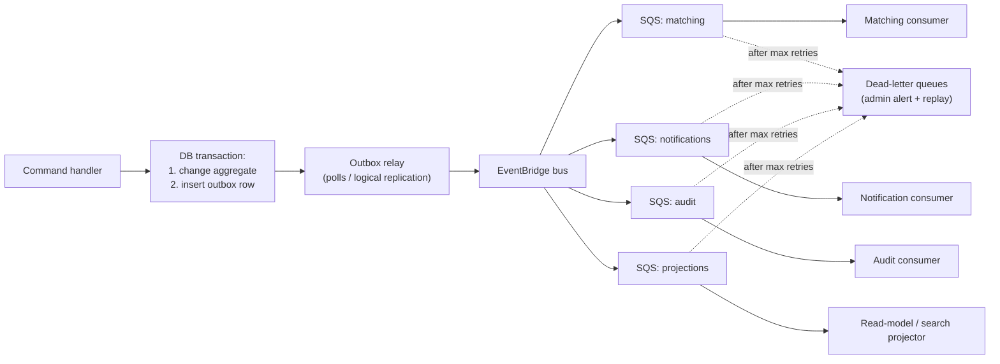

# Event Architecture

## 1. Orchestration and choreography

- **Orchestration (Temporal)** is used where one process must control steps, wait, compensate, and guarantee outcomes: application pipeline, approvals, discovery cycles, account deletion, reconciliation.
- **Choreography (domain events)** is used where contexts react independently: a new opportunity triggers matching, a status change triggers notifications and audit, a profile change triggers re-matching.

## 2. Reliable publishing: transactional outbox



- An event is published **only if** its transaction committed; nothing is lost if the process crashes.
- Delivery is **at least once**; every consumer is idempotent using an **inbox table** keyed by event ID.
- Ordering per aggregate where needed (for example application status events) uses FIFO queues with the aggregate ID as the message group.
- Events can be **replayed** from the archive (EventBridge archive / outbox history) to rebuild projections.

## 3. Event envelope (CloudEvents 1.0)

```json
{
  "specversion": "1.0",
  "id": "0192f6c1-...",
  "source": "careerpilot/applications",
  "type": "careerpilot.applications.application.submission_confirmed.v1",
  "subject": "application/0192f...",
  "time": "2026-11-02T18:03:12Z",
  "datacontenttype": "application/json",
  "tenantid": "default",
  "traceparent": "00-...",
  "data": {
    "application_id": "0192f...",
    "user_id": "0192a...",
    "opportunity_version_id": "0192b...",
    "route_type": "ats",
    "evidence_ids": ["0192c..."]
  }
}
```

Rules:
- Naming: `careerpilot.<context>.<entity>.<past_tense_event>.v<major>`.
- Payloads carry IDs and minimal facts, not full personal data (consumers fetch details through module interfaces if authorized). This limits personal data spreading through queues.
- Schemas are JSON Schema files in `services/core/src/careerpilot/<context>/domain/events/`, registered in the schema registry; CI checks compatibility (additive changes only within a major version).

## 4. Event catalogue (v1)

| Event | Producer | Main consumers |
|---|---|---|
| `identity.user.registered` | Identity | Notification (set-password link), Audit |
| `identity.user.activated` | Identity | Profile, Audit |
| `identity.user.suspended` / `deletion_requested` / `deleted` | Identity | Automation (stop), Notification, Audit, Ops |
| `profile.fact.changed` | Profile | Matching, Automation (re-check approvals), Audit |
| `documents.version.approved` / `expired` | Documents | Automation, Notification |
| `preferences.track.changed`, `preferences.country_exclusion.changed`, `preferences.compensation_rule.changed` | Preferences | Matching, Automation |
| `preferences.auto_rule.activated` / `paused` / `revoked` / `expired` | Preferences | Automation, Notification, Audit |
| `preferences.pause.started` / `ended` | Preferences | Automation, Notification |
| `discovery.cycle.completed` / `failed` | Discovery | Administration (health), Projections |
| `discovery.raw_posting.fetched` | Discovery | Opportunities (extraction) |
| `opportunities.opportunity.published` / `changed` / `closed` / `withdrawn` | Opportunities | Matching, Automation, Notification |
| `opportunities.fraud_flag.raised` / `resolved` | Opportunities | Automation (block), Notification, Administration |
| `matching.recommendation.created` | Matching | Notification (digest), Automation (rule candidates), Projections |
| `applications.application.created` | Applications | Projections, Audit |
| `applications.approval.requested` / `approved` / `rejected` / `expired` | Applications | Notification, Matching (feedback), Audit |
| `applications.application.submission_started` / `submitted` / `submission_confirmed` / `submission_failed` / `outcome_unknown` / `manual_action_required` / `cancelled` | Applications | Notification, Tracking, Projections, Audit, Ops (reconciliation) |
| `applications.application.outcome_changed` | Applications / Tracking | Notification, Insights, Matching (feedback) |
| `applications.question.unanswered` | Applications | Notification, Question bank projection |
| `communication.reply.classified` | Communication | Tracking, Applications (suggested outcome) |
| `payments.payment.confirmed` / `failed` / `uncertain` | Payments | Applications, Notification, Audit |
| `automation.emergency_stop.activated` / `released` | Automation / Administration | All workers, Notification, Audit |
| `notifications.delivery.failed` | Notification | Administration (health), fallback logic |
| `administration.setting.changed`, `administration.flag.changed` | Administration | All modules (config cache refresh), Audit |
| `audit.sensitive_data.accessed` | Admin API | Audit, Notification (per policy) |
| `ops.reconciliation.issue_found` | Ops | Administration, Notification |

## 5. Projections (read models)

Built from events for fast reads and decoupling:

| Projection | Used by |
|---|---|
| Applications list (per user, denormalized) | User apps (Section 28.1) |
| Daily/weekly report aggregates | Reports (Section 28.4) |
| Admin dashboard metrics | Admin app (Section 53.3) |
| Question bank statistics | Users and admins (Section 28.3) |
| Search index (future OpenSearch) | Opportunity and record search |

Projections can be rebuilt from scratch by replaying events.

## 6. Evolution

- When volume or the number of independent consumers grows, the bus moves to Kafka (Amazon MSK) with the same CloudEvents envelope and schemas.
- Extracted services (evolution Stage 2) keep using the same events; no consumer changes are needed.
- Outbound webhooks for partners (Stage 3) are another consumer that maps selected events to partner-visible payloads.
