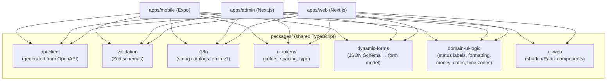

# Front-end Architecture (Web, Admin, Mobile)

## 1. Shared foundation



- Business rules are **not** re-implemented in front ends; they display what the API returns (status, reasons, explanations).
- `domain-ui-logic` holds display logic only (status labels and colours with text, money/date formatting, time-zone display), so all three apps show the same meaning.
- `dynamic-forms` turns opportunity-type and settings JSON Schemas into a form model; each app renders it with its own components (web, admin, mobile). New fields appear without app releases (see [05-Extensibility-Framework.md](05-Extensibility-Framework.md)).

## 2. Feature-based structure

Each app is organized by feature, not by technical type:

```text
apps/web/src/
├── app/                      # Next.js routes (thin)
├── features/
│   ├── onboarding/
│   ├── profile/
│   ├── documents/
│   ├── tracks/
│   ├── recommendations/
│   ├── opportunity-detail/   # includes archived circular viewer
│   ├── approvals/
│   ├── applications/         # list + detail (timeline, Q&A, emails, files, evidence)
│   ├── rules/
│   ├── pauses-and-windows/
│   ├── tracking/             # interviews, assessments, offers
│   ├── academic/
│   ├── notifications/
│   ├── reports/
│   └── account-privacy/
├── shared/                   # app-level hooks, layout, providers
└── bff/                      # route handlers: session, token exchange, API proxy
```

Each feature contains `components/`, `hooks/` (TanStack Query), `screens/` or route segments, and `tests/`. Features don't import from each other's internals; shared things move to `shared/` or `packages/`.

## 3. User web app

| Topic | Design |
|---|---|
| Rendering | Next.js App Router; server components for initial data where safe, client components for interactive screens |
| Authentication | **Backend-for-Frontend:** Next.js server performs the OIDC code flow, stores tokens server-side, and gives the browser an httpOnly, Secure, SameSite cookie. Browser JavaScript never sees access tokens |
| Data fetching | TanStack Query through the BFF proxy; optimistic updates only for safe local actions (save, dismiss), never for submissions |
| Real-time | SSE stream for application status, approvals waiting, notifications |
| State | Server state in TanStack Query; small UI state in component state or Zustand |
| Forms | React Hook Form + Zod; dynamic forms for metadata-driven fields |
| Accessibility | Radix primitives, axe checks in CI, keyboard paths for approvals and records |
| Performance | Route-level code splitting, image optimization, performance budgets in CI (Core Web Vitals) |
| i18n | next-intl with English only in v1 (locale routing ready for Bangla later); Bangla font support for displaying Bangla circulars and documents |

## 4. Admin web app

| Topic | Design |
|---|---|
| Separation | Separate Next.js app, domain, deployment, and Keycloak admin realm |
| Permission-aware UI | The admin API returns the current admin's permissions; screens and actions show only what the role allows (server still enforces) |
| Data grids | TanStack Table with server-side filtering, sorting, pagination, column chooser, CSV/PDF export |
| Dashboards | Metric cards and charts from read-model endpoints; drill-down to records |
| View as user | Renders the user app's feature components in read-only mode with a persistent banner and audit |
| Sensitive data | Masked by default; "reveal" requires a reason and is audited |
| Session security | MFA, short idle timeout, re-auth for destructive and bulk actions |

## 5. Mobile app (Android and iOS)

| Topic | Design |
|---|---|
| Framework | Expo (managed workflow with config plugins), Expo Router |
| Authentication | OIDC with PKCE (expo-auth-session); refresh token in secure storage; biometric unlock |
| Push | expo-notifications; categories with action buttons (Approve, Answer, Open); deep links to the exact item |
| Offline | expo-sqlite cache of recent applications, records, and archived circular metadata; TanStack Query persistence |
| Offline actions | Stored in a local outbox queue, shown as "Pending"; sent with idempotency keys when online; conflicts resolved with ETags (server wins, user informed) |
| Files | Document and image pickers; camera for photo/signature with crop guides; uploads via presigned URLs with resume and progress |
| Updates | EAS Update for JavaScript fixes; store releases for native changes; minimum supported version check |
| Security | Certificate pinning (optional), jailbreak/root detection warning, screenshot blocking on sensitive screens (optional), no secrets in the bundle |
| Accessibility | Screen reader labels, dynamic type, contrast |

## 6. Design system

- Design tokens (colour, spacing, typography, radius, motion) defined once in `ui-tokens`, exported to Tailwind (web/admin) and NativeWind (mobile).
- Light theme only in v1 (tokens ready for a dark theme later); status colours always paired with text labels and icons (requirements Section 28.5).
- Figma library mirrors the tokens and components; Code Connect can link Figma components to code later.
- Bangla text inside content (circulars, names) renders correctly with a Bangla-capable font.

## 7. Front-end quality

| Area | Practice |
|---|---|
| Testing | Unit tests only in v1: Vitest + Testing Library (web/admin), Jest + React Native Testing Library (mobile) |
| Errors | Sentry with PII scrubbing; error boundaries per feature |
| Analytics | Consent-based PostHog events with a typed event catalogue |
| Feature flags | OpenFeature client; flags evaluated server side for web, cached for mobile |
| Security | Strict Content-Security-Policy, no inline scripts, dependency scanning, no tokens in local storage on web |
