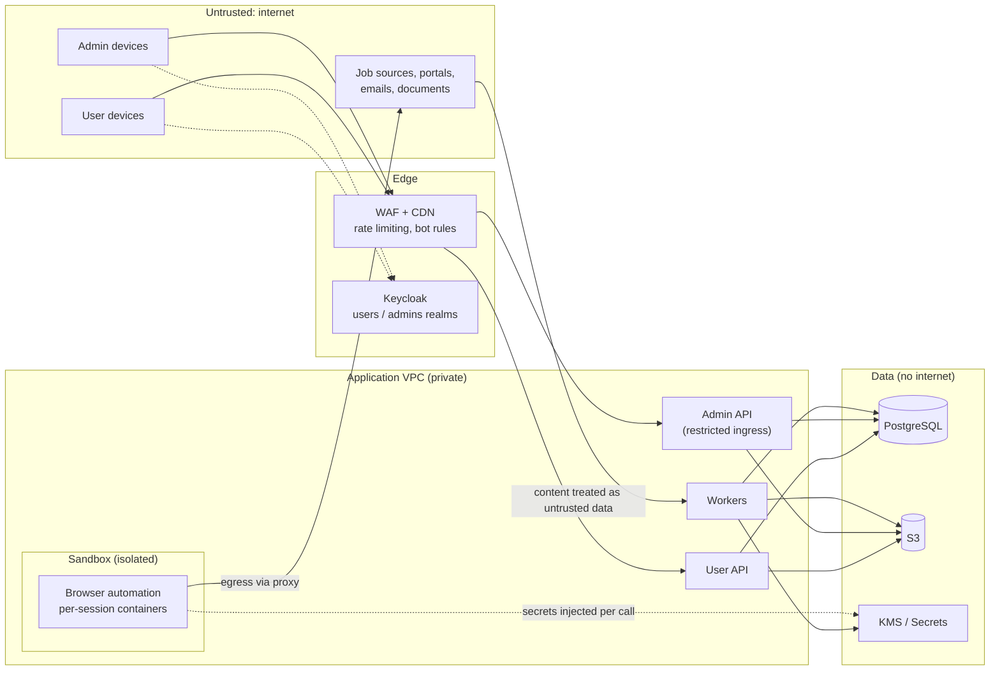

# Security and Privacy Architecture

## 1. Trust boundaries

## 2. Threat model (STRIDE)

| Asset / flow | Threat | Mitigations |
|---|---|---|
| User accounts | **Spoofing**: credential stuffing, phishing | MFA, passkeys (WebAuthn), breached-password checks, rate limits, new-login alerts |
| Admin accounts | Spoofing / privilege abuse | Separate realm, mandatory MFA, short sessions, IP allow-list option, least-privilege roles, audit of every sensitive view |
| Portal credentials | **Information disclosure** | KMS envelope encryption, per-user data keys, no read-back API, decrypted only inside the sandbox for one call, access logged |
| Applications, submissions | **Tampering**: altered records | Append-only tables, hash-chained audit, S3 Object Lock for evidence, DB roles without UPDATE on immutable tables |
| Actions by system | **Repudiation**: "I never approved this" | Signed approval records (who, when, device, what was shown), audit chain |
| Job postings, emails | **Prompt injection / malicious content** | Content passed as data, no tools on untrusted-content AI calls, output schema validation, claim checks, injection flags |
| Uploaded files | Malware, parser exploits | Antivirus scan (ClamAV), type sniffing, size limits, conversion in isolated workers |
| Browser automation | Sandbox escape, cross-user leakage | One container per session, no shared profiles, read-only images, egress proxy, resource limits, wiped after use |
| APIs | **Denial of service** | WAF, per-user/IP rate limits, quotas, autoscaling, bulkheads between worker pools |
| Authorization | **Elevation of privilege** / IDOR | Policy engine checks on every request (owner + tenant + role), row-level security as second layer, tests for every endpoint |
| Webhooks (WhatsApp, mail) | Forged callbacks | Signature verification, replay protection (timestamps, nonces) |
| Supply chain | Malicious dependencies / plugins | Pinned and scanned dependencies, signed container images, plugin review, SBOM |

## 3. Identity and access

| Topic | Design |
|---|---|
| Authentication | Keycloak OIDC: `users` realm (password + optional MFA, passkeys, social login optional), `admins` realm (MFA mandatory) |
| Sessions | Short access tokens, rotating refresh tokens, device list, sign out everywhere, re-authentication for sensitive actions (requirements Section 41) |
| Authorization | Role-based (admin roles) + attribute-based (owner, tenant, data class, purpose) decisions in a policy engine (Cedar or OPA, chosen in Sprint 0) |
| Defense in depth | Postgres row-level security by `tenant_id`/`user_id`; admin API uses a separate DB role |
| Service identity | Each service/worker has its own IAM role and DB role with only needed permissions |
| Connected accounts | OAuth with minimum scopes (send-only where possible; read limited to application threads where the provider allows) |

## 4. Data protection

| Layer | Control |
|---|---|
| In transit | TLS 1.2+ everywhere, HSTS, internal TLS between services |
| At rest | RDS and S3 encryption with KMS customer-managed keys |
| Field level | Sensitive identity fields and credentials encrypted with envelope encryption; blind indexes for lookups |
| Keys | Rotation yearly (automatic), separate keys per data class and environment |
| Logs | PII and secret scrubbing at the logger; no request bodies with personal data in logs |
| Backups | Encrypted, cross-region, access restricted |
| Deletion | Crypto-shredding for per-user keys on account deletion (removes access to any remaining encrypted copies) |

## 5. Privacy by design

- Data minimization: optional sensitive fields; AI tasks receive only needed fields; events carry IDs not personal data.
- Purpose limitation and consent records per purpose (matching, applications, analytics, inbox reading).
- User rights built in: access, correction, export, deletion (requirements Sections 13, 46).
- Transparency: privacy notice covers admin access, AI providers, third-party sharing per application (requirements Sections 40, 53.5).
- Data processing agreements with all processors (cloud, AI, messaging, email).
- Data residency decision recorded (AWS region, decision T1).

## 6. AI-specific security (OWASP Top 10 for LLM applications)

| Risk | Control |
|---|---|
| Prompt injection | Untrusted content isolated as data; system prompts instruct to ignore embedded instructions; no external-acting tools on those calls |
| Sensitive information disclosure | Minimal context per task; no other users' data ever in a prompt; outputs scanned for unexpected personal data |
| Improper output handling | Structured outputs validated against schemas; outputs never executed; HTML escaped |
| Excessive agency | AI cannot submit, send, or pay; only code paths with checks can |
| Misinformation / hallucination | Evidence quotes, confidence, claim check, "unverified" labels |
| Unbounded consumption | Per-user and platform AI budgets, max tokens, rate limits |
| Supply chain / model changes | Model version pinned per task, eval gate before changes |

## 7. Secure development lifecycle

- Threat model reviewed when a new route adapter, channel, or data class is added.
- SAST (CodeQL), dependency and container scanning, secret scanning on every pull request.
- DAST (OWASP ZAP) against staging weekly.
- Independent penetration test before production launch and yearly after.
- Security champions review authentication, credentials, automation, payments, and admin changes.

## 8. Incident response

- Runbooks for credential exposure, data breach, account takeover, mass mis-submission, and source terms violations.
- Ability to: revoke all sessions, rotate keys, disable a plugin, activate the platform emergency stop, and notify affected users promptly (requirements Section 41).
- Post-incident reviews are blameless and produce tracked actions.
