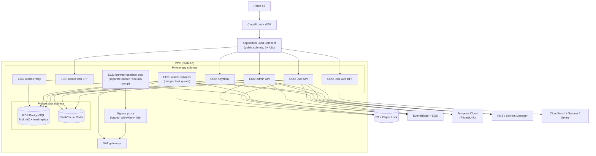
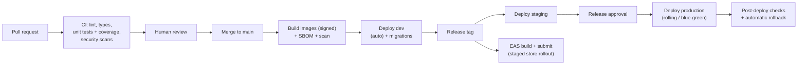

# Infrastructure, Deployment, and Operations

> **Stages.** Sections 1–4 describe the **scale-stage** target. Version 1 launches on the low-cost **lean stage** (one ARM EC2 instance with Docker Compose, small RDS, S3, CloudFront, Grafana Cloud free tier) defined in [../12-Cost-Plan.md](../12-Cost-Plan.md); the same containers move to this target without code changes. Detailed observability is in [../11-Observability.md](../11-Observability.md), which supersedes §7 where they differ.

## 1. AWS account structure

| Account | Purpose |
|---|---|
| Management | AWS Organizations, billing, SSO |
| Security | GuardDuty, Security Hub, CloudTrail aggregation |
| Log archive | Central immutable logs |
| Dev | Development environment |
| Staging | Release candidates, beta |
| Production | Live system |

Separate accounts limit the impact of mistakes and breaches. Access via AWS IAM Identity Center with MFA.

## 2. Production deployment

- Admin web and admin API sit behind a separate ALB listener/host with optional IP allow-list and stricter WAF rules.
- The browser sandbox pool runs in its own security group and cluster with no access to the database; it receives only the data for one job and returns results to the application worker.
- VPC endpoints for S3, SQS, KMS, Secrets Manager keep internal traffic off the internet.

## 3. Scaling

| Service | Scaling signal | Notes |
|---|---|---|
| User API / Admin API | CPU and request count | Stateless; min 2 tasks across AZs |
| Web BFFs | CPU and request count | Stateless |
| Discovery workers | Temporal task-queue backlog | Respect per-source rate limits |
| AI workers | Backlog + AI budget | Batch API for nightly bulk |
| Matching workers | Backlog | Scales with new opportunities × candidate users |
| Application workers + browser pool | Backlog and scheduled submissions per window | Pre-warm before popular windows (for example 12:00 a.m.) |
| Notification workers | Backlog | Digest bursts at popular times |
| PostgreSQL | Vertical size, read replicas, partitioning | Connection pooling (RDS Proxy / PgBouncer) |
| Redis | Cluster mode when needed | — |

## 4. Resilience

| Mechanism | Where |
|---|---|
| Multi-AZ | All services and RDS |
| Timeouts, retries with jitter | All outbound calls |
| Circuit breakers | Per source, route adapter, AI provider, messaging channel |
| Bulkheads | Separate worker pools per task queue; browser pool isolated |
| Dead-letter queues | Every SQS consumer; replay tools in admin |
| Graceful degradation | AI unavailable → extraction queued, manual review; WhatsApp down → push/email fallback |
| Load shedding | Rate limits and queue back-pressure under overload |

## 5. Disaster recovery

| Item | Target / method |
|---|---|
| RPO | ≤ 15 minutes (RDS point-in-time recovery, cross-region snapshot copies, S3 cross-region replication) |
| RTO | ≤ 4 hours (infrastructure as code redeploy in the recovery region, restore database, replay outbox) |
| Drills | Quarterly restore drill; reconciliation after every restore |
| Runbooks | `docs/runbooks/` for region failure, database restore, key compromise, provider outage |

## 6. CI/CD pipeline

- Database migrations follow expand-and-contract so app versions N and N+1 both work during deploys.
- New risky behaviour ships behind feature flags; route adapters roll out by percentage of users.
- Mobile: staged rollout in Google Play and phased release in App Store; EAS Update for JavaScript fixes; minimum version enforcement for breaking API changes.

## 7. Observability

| Signal | Tooling | Content |
|---|---|---|
| Traces | OpenTelemetry → Grafana Tempo / X-Ray | Request → workflow → activity → external call → event, all with one trace ID |
| Metrics | OpenTelemetry → Prometheus / CloudWatch | RED (rate, errors, duration) for APIs; queue depth; per-plugin success rates; AI tokens and cost; submissions by status |
| Logs | Structured JSON → CloudWatch / Loki | PII-scrubbed; linked to trace IDs |
| Errors | Sentry | Backend, web, admin, mobile |
| Business monitors | Dashboards + alerts | Digest timeliness, submission success per route, outcome-unknown count, reconciliation issues, fraud flags |

### Service level objectives (initial)

| SLO | Target |
|---|---|
| User API availability | 99.9% / 30 days |
| Read latency p95 | < 300 ms |
| Digest delivered within 15 min of scheduled time | 99% |
| Scheduled submission started within 10 min of window | 99% |
| Reconciliation issues unresolved > 24 h | 0 |

Alerts are based on error-budget burn rates, with on-call rotation and runbooks.

## 8. Cost management

- Tags on every resource (environment, service, owner); monthly budgets with alerts.
- AI and messaging spend tracked per user and per feature in the admin dashboard.
- Savings: Graviton instances, Fargate Spot for non-urgent workers (discovery, batch extraction), S3 lifecycle rules, Batch API for bulk AI work.
