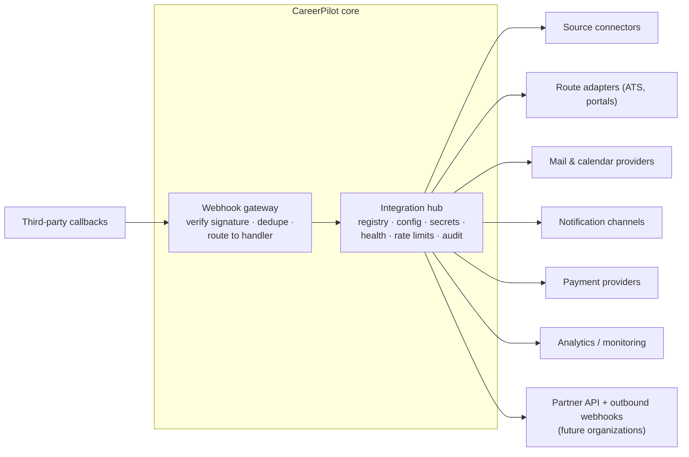
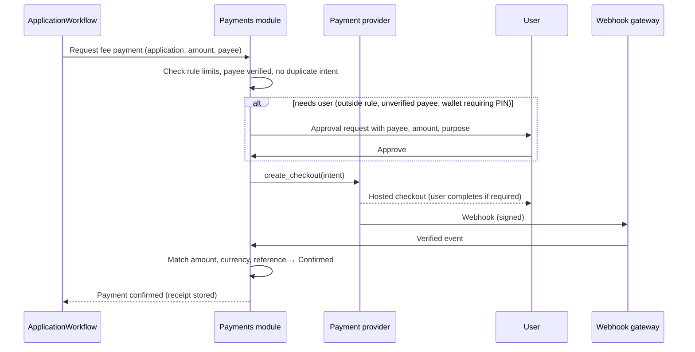

# Third-party Integrations and Payments

Implements requirements §10.10 and §10.11 using the plugin framework in [05-Extensibility-Framework.md](05-Extensibility-Framework.md).

## 1. Integration hub



Every integration:
- is a plugin with a key, version, config schema, and capability list;
- stores secrets only in the secret store (never in the database in plain text or in code);
- is enabled, configured, monitored, and disabled from the admin app, with health and error rates;
- has a circuit breaker, rate limit, timeout, and retry policy;
- logs every call with trace IDs (no secrets or personal data in logs);
- has a mock in `mocks/` so local, dev, CI, and staging never call the real service.

## 2. Payment provider interface

```python
class PaymentProvider(Plugin, Protocol):
    key: str                              # e.g. "pay.sslcommerz", "pay.bkash", "pay.stripe"
    currencies: set[str]
    methods: set[PaymentMethod]           # card, mobile_wallet, bank
    async def create_checkout(self, intent: PaymentIntent) -> Checkout: ...      # hosted page / redirect URL / deep link
    async def get_status(self, provider_ref: str) -> PaymentStatus: ...          # for verification of uncertain payments
    def verify_webhook(self, headers: Mapping[str, str], body: bytes) -> WebhookEvent: ...  # signature + replay checks
    async def refund(self, provider_ref: str, amount: Money) -> RefundResult: ...
```

Design rules:
- **No card data in CareerPilot.** Only hosted checkout or tokenization, so card data stays with the provider (keeps PCI scope minimal).
- **Payment intents first.** A `PaymentIntent` record (amount, currency, payee, purpose, application, idempotency key) is written before redirecting.
- **Confirmation only from verified evidence:** a verified webhook or a status query, with amount, currency, and reference matching the intent (requirements §10.10, §10.11).
- **Duplicate callbacks** are ignored using the provider event ID (inbox table).
- **Uncertain payments** go to a verification workflow; never retried blindly (state machine in [07-State-Machines.md](07-State-Machines.md) §10).
- **Rule limits** (amount per application, total, allowed payees and methods) are checked by the core before any checkout is created.

## 3. Payment flow



Many wallet payments need the user's PIN or OTP; those always involve the user (requirements §27.3). SMS-based government fee payments are tracked, not automated.

## 4. Candidate providers (decided in planning of the payments epic)

| Provider type | Examples | Use |
|---|---|---|
| Bangladesh payment gateways | SSLCommerz, bKash, Nagad | Local fees, future subscriptions |
| International card gateway | Stripe or similar (availability in Bangladesh to be checked) | International fees, future subscriptions |

Provider choice depends on merchant availability, fees, and settlement rules; it is a configuration decision because all providers implement the same interface.

## 5. Future subscriptions (if introduced)

The same payment interface supports subscription billing for CareerPilot features. Plans, entitlements, and invoices would be a separate `billing` module; nothing in the current design blocks it.
