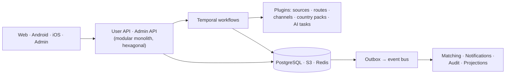

# CareerPilot Design

Architecture and design for version 1, from the highest level down to code contracts. It builds on the [requirements](../../Requirement%20Analysis/Requirements.md) and the [planning documents](../README.md).

## Reading order (high level → low level)

| Level | Document | Contents |
|---|---|---|
| Foundations | [01-Principles-and-Quality-Attributes.md](01-Principles-and-Quality-Attributes.md) | Drivers, 15 principles, measurable quality targets, evolution path |
| C4 L1–L2 | [02-C4-Context-and-Containers.md](02-C4-Context-and-Containers.md) | System context, containers, container catalogue |
| Domain | [03-Domain-Model.md](03-Domain-Model.md) | 19 bounded contexts, context map, aggregates and invariants, events |
| C4 L3–L4 | [04-Component-Design.md](04-Component-Design.md) | Hexagonal modules, code layout, component diagrams, plugin interfaces |
| Extensibility | [05-Extensibility-Framework.md](05-Extensibility-Framework.md) | Extension points, plugins, metadata-driven types, CEL rules, config hierarchy, flags, recipes |
| Data | [06-Data-Model.md](06-Data-Model.md) | Conventions, ERDs per context, physical design |
| Behaviour | [07-State-Machines.md](07-State-Machines.md) | 13 state machines (applications, approvals, opportunities, rules, pauses, accounts, ...) |
| Behaviour | [08-Sequence-Flows.md](08-Sequence-Flows.md) | 14 end-to-end flows |
| Interfaces | [09-API-Design.md](09-API-Design.md) | API conventions, user and admin resource catalogues |
| Integration | [10-Event-Architecture.md](10-Event-Architecture.md) | Outbox, event bus, envelope, event catalogue, projections |
| Clients | [11-Frontend-Architecture.md](11-Frontend-Architecture.md) | Web, admin, mobile structure; BFF; offline; dynamic forms; design system |
| Security | [12-Security-Architecture.md](12-Security-Architecture.md) | Trust boundaries, STRIDE, identity and access, data protection, AI security |
| Operations | [13-Infrastructure-and-Operations.md](13-Infrastructure-and-Operations.md) | AWS deployment, scaling, resilience, DR, CI/CD, observability, SLOs, cost |
| Decisions | [14-ADR-Log.md](14-ADR-Log.md) | 20 architecture decisions with alternatives |

## Design at a glance

Growth principle: most change is **configuration** (types, fields, rules, limits, templates, flags), the rest is a **plugin**; the core (safeguards, status model, precedence) changes only with the requirements.
